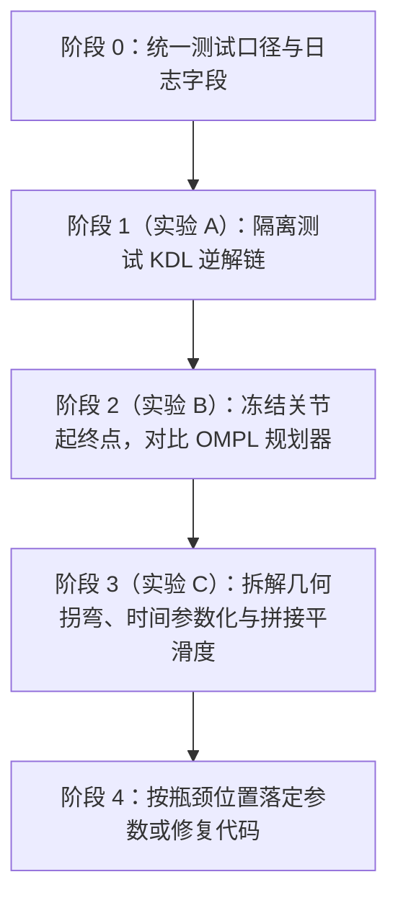

# 桌面抓取算法诊断与测试计划

本文给出 [scene_gento_skye.py](scene_gento_skye.py) 与 [plan_gento_skye.py](../plan_gento_skye.py) 的分层测试方案，用于定位两类问题：

1. **为什么规划容易失败**：问题出在 KDL 逆解（`/compute_ik`）、肘部与碰撞筛选，还是 OMPL 路径搜索（`/plan_kinematic_path`）？
2. **为什么轨迹不够平滑**：问题出在几何路径绕行、客户端直线插值绕过时间参数化、多段拼接丢弃速度/加速度，还是 RViz 逐点回放？

相关背景见 [一次规划里的两段循环](../tutorials/kdl_ompl.md)、[规划结果](../tutorials/performance.md)、[计算开销](../tutorials/efficiency.md)、[桌面抓取的拼接轨迹](grasp_trajectory_workflow.md) 与 [关节限制说明](joint_limits.md)。

> **核心原则：** 先把 KDL 逆解、OMPL 几何搜索、时间参数化与拼接回放拆成独立实验，每次只放开一个变量；不要在未冻结逆解和未区分停止规则的情况下直接对 13 个规划器做耗时排名。

---

## 1. 测试前已对齐并修复的代码现状

当前 [scene_gento_skye.py](scene_gento_skye.py) 中容易干扰测试结论的 5 处边界已完成统一修复：

1. **夹爪常量语义已对齐几何实情**（[scene_gento_skye.py](scene_gento_skye.py#L96-L109)）：
   - 指爪棱柱关节 `0.0 m` 时两指中心线间距约 `0.11 m`（张开），`0.012 m` 夹持 `0.06 m` 方块，`0.04 m` 完全合拢。
   - 现已将 `GRIPPER_OPEN = FINGER_SPREAD = 0.0`、`GRIPPER_CLOSED = FINGER_HOLD = 0.012`、`GRIPPER_FULLY_CLOSED = 0.04` 对齐，并在 `reset_to_home()`、`install_trajectory()` 与起始有效性检查中统一使用 `FINGER_SPREAD`。
2. **`choose_arm()` 的单臂三阶段同姿态链式逆解已输出分阶段失败统计**（[scene_gento_skye.py](scene_gento_skye.py#L995-L1083)）：
   - 枚举右臂/左臂与 6 个水平 `yaw` 角（$0^\circ, 90^\circ, -90^\circ, 45^\circ, -45^\circ, 180^\circ$），手指朝下。
   - `solve_side()` 按 `stage=pregrasp|grasp|lift` 单独打印 `no_ik` 或 `goal_collision`，外层汇总 `pregrasp_fails`、`grasp_fails`、`grasp_hold_fails`、`lift_fails`。
3. **`lift` 阶段的规划开度与回放开度已统一为 `FINGER_HOLD`**：
   - `choose_arm()` 先验证 `grasp` 构型在 `FINGER_HOLD`（`0.012 m`）下无碰撞，再用 `FINGER_HOLD` 求解并验证 `lift`；`main()` 在 `move_in` 结束后复核实际到达构型在 `FINGER_HOLD` 下无碰撞，并以 `FINGER_HOLD` 规划 `lift`（[scene_gento_skye.py](scene_gento_skye.py#L1028-L1158)）。
   - 注意：`cube` 在规划 `lift` 时仍是桌面上的世界碰撞体，回放时才通过 `CollisionObject.MOVE` 跟随指尖移动（[scene_gento_skye.py](scene_gento_skye.py#L760-L771)）。
4. **默认已关闭 `interpolated_motion()`，所有阶段默认走 OMPL 与 TOTG**：
   - `plan_between()` 默认 `allow_interpolation=False`（[scene_gento_skye.py](scene_gento_skye.py#L604-L615)），默认直接调用 `plan_group()` 走 OMPL 与 `AddTimeOptimalParameterization`（TOTG）。只有显式传入 `--allow-interpolation` 时才启用客户端关节直线插值。
5. **拼接过程已保留速度与加速度字段，但仍需核对段间导数连续性**：
   - `take_segment()` 与 `point_at()` 现已将各段 `velocities` 和 `accelerations` 映射到完整关节列表（[scene_gento_skye.py](scene_gento_skye.py#L790-L838)），`interpolated_motion()` 与 `ramp_grippers()` 也会写入对应的速度与零加速度。
   - 但段与段直接顺延时间戳拼接，未对整段拼接轨迹重跑一次全局时间参数化，因此仍需对比消息内的 `velocities`/`accelerations` 与位置有限差分是否一致。

---

## 2. 总体诊断路线图



| 阶段 | 被测对象 | 冻结不动的内容 | 回答的核心问题 |
|---|---|---|---|
| **实验 A** | `/compute_ik` + `elbow_in_front` + `/check_state_validity` | 不调用 `/plan_kinematic_path`，固定场景与 TCP 位姿 | 到底是 KDL 解不出、肘部过滤太严、目标构型碰撞，还是相邻阶段关节跳支？ |
| **实验 B** | `/plan_kinematic_path`（OMPL 各算法） | 冻结实验 A 产出的关节起终点，关闭客户端直线插值 | 在完全相同的关节起终点上，哪个规划器成功率和路径质量最好？ |
| **实验 C** | `interpolated_motion` + TOTG + `take_segment` + `play_on_model` | 固定同一条成功几何路径或同一组三阶段关节解 | 不平滑发生在几何采样、直线/OMPL 混合、段间拼接，还是 RViz 回放？ |

---

## 3. 阶段 0：测试环境与日志准备

### 3.1 启动与保活基线

每次测试前确保只有一份 MoveIt + RViz 演示进程在跑，并加载桌面场景（详细命令见 [gento_skye_rviz.md](gento_skye_rviz.md)）：

```bash
source /opt/ros/humble/setup.bash
source "$HOME/.local/opt/ros-humble-user/local_setup.bash"
cd ~/Projects/motion_planning_from_scratch
./scripts/rviz_plan_execute.sh
```

出现 `ready=scene_and_home` 后，再运行各阶段实验。

### 3.2 必须补齐的诊断日志字段

当前终端输出只有 `no_ik`、`goal_valid`、`error_code` 和 `duration_sec`（轨迹时长）。采集测试数据时，每条记录需区分以下字段：

| 类别 | 字段名 | 说明 |
|---|---|---|
| **IK 诊断** | `arm`, `yaw_deg`, `stage` | 左右臂、候选偏航角、`pregrasp` / `grasp` / `lift` |
| | `kdl_error_code`, `ik_wall_ms` | `/compute_ik` 原始返回码与服务调用耗时（毫秒） |
| | `fk_pos_err_m`, `fk_rot_err_rad` | 对 IK 解做 `/compute_fk` 复算的位置与姿态误差 |
| | `elbow_ok`, `elbow_xyz` | `elbow_in_front()` 判定结果与 `Link4_R` / `Link4_L` 坐标 |
| | `goal_valid`, `contact_pairs` | `/check_state_validity` 结果与碰撞连杆对 |
| | `step_joint_dist_l2`, `step_joint_peak_rad` | 与上一阶段 `seed` 的 7 轴欧氏距离 $\|\Delta q\|_2$ 与单轴最大跳变 $\max_i |\Delta q_i|$ |
| **规划诊断** | `planner`, `allowed_time_s`, `attempts` | 规划器名、`--time`、`num_planning_attempts` |
| | `branch` | `joint_interpolation` 或 `ompl` |
| | `plan_error_code`, `plan_wall_ms` | 规划返回码与**服务墙钟耗时**（注意与轨迹执行时长区分） |
| | `waypoints`, `traj_duration_s` | 轨迹点数与末点 `time_from_start` |
| | `path_length_l2`, `max_turn_angle_rad` | 关节空间折线总长 $\sum_k \|q_k - q_{k-1}\|_2$ 与相邻步最大转折角 |
| **平滑诊断** | `has_vel_acc_fields` | 轨迹点是否非空携带 `velocities` / `accelerations` |
| | `fd_vel_peak`, `fd_acc_peak`, `fd_jerk_rms` | 按 `(positions, time_from_start)` 有限差分算出的速度峰值、加速度峰值、加加速度均方根 |
| | `sign_flips` | 单段内各关节角速度符号翻转次数（衡量来回抖动） |
| | `boundary_pos_jump`, `boundary_vel_jump` | 段与段拼接处的关节位置差与有限差分速度跳变 |

---

## 4. 阶段 1（实验 A）：KDL 逆解与三阶段解链诊断

**目标：** 在不调用任何路径规划器的前提下，确认 `compute_ik` 是否是主瓶颈。

### A1. 已知可达位姿的 FK $\to$ IK 闭环自检

1. 在无碰撞构型（如 `home` 附近及若干合法关节角 $q_{\text{ref}}$）下调用 `/compute_fk` 获取 `TCP_Link_R` / `TCP_Link_L` 位姿。
2. 将该位姿原样送入 `/compute_ik`（`lock_orientation=True`，超时 `250 ms`）：
   - **自检组 1**：以 $q_{\text{ref}}$ 本身作为 `seed`；
   - **自检组 2**：在 $q_{\text{ref}}$ 上施加 $\pm 0.1\ \mathrm{rad}$ 与 $\pm 0.3\ \mathrm{rad}$ 扰动作为 `seed`；
   - **自检组 3**：以 `home`（全 0）作为 `seed`。
3. 对返回解 $q_{\text{sol}}$ 再次调用 `/compute_fk`，核对位置误差与姿态误差（7 轴冗余臂不要求 $q_{\text{sol}} = q_{\text{ref}}$，只要求末端位姿收敛且关节在限位内）。

**判据：**
- 若自检组 1/2 都出现失败，说明问题在 **TCP 坐标系、关节限位配置或 KDL 插件参数**，严禁进入 OMPL 调参。

### A2. 桌面抓取三阶段候选矩阵拆解

固定桌面与障碍球场景，遍历 `right_arm` / `left_arm` $\times$ 6 个 `yaw` 角 $\times$ 超时（`250 ms` vs `1000 ms`）$\times$ 20 组固定随机种子/起始微扰，逐阶段记录通过率：

$$\text{请求总数} \xrightarrow{\text{KDL 收敛}} N_{\text{ik}} \xrightarrow{\text{elbow\_in\_front}} N_{\text{elbow}} \xrightarrow{\text{goal\_is\_valid}} N_{\text{valid}}$$

同时检查两项**跨阶段指标**：

1. **短距笛卡尔移动是否引起关节跳支**：
   - `pregrasp` 到 `grasp` 末端只下降 `0.12 m`，若 $\|q_{\text{grasp}} - q_{\text{pregrasp}}\|_\infty > 0.8\ \mathrm{rad}$，说明 KDL 在冗余流形上跳到了另一分支，后续无论走直线还是 OMPL 都会出现大幅甩臂。
2. **`lift` 目标在不同夹爪开度下的有效性**：
   - 分别用 `FINGER_SPREAD`（`0.0 m`）和 `FINGER_HOLD`（`0.012 m`）调用 `goal_is_valid()`，核对指爪在闭合夹持宽度下是否与 `cube` 或桌面发生碰撞。

**实验 A 决策表：**

| 实验 A 观察到的现象 | 根因定位 | 下一步动作 |
|---|---|---|
| $N_{\text{ik}}$ 极低，延时到 `1000 ms` 仍无解 | 目标位姿超出可达工作空间或姿态锁死过严 | 调整抓取候选 `xyz` / `yaw` 或放宽姿态容差 |
| $N_{\text{ik}}$ 高，但大多死在 `elbow_in_front()` | 肘部启发式阈值（$x>0.25, z<1.05, y\cdot\text{side}>-0.05$）与当前抓取姿态冲突 | 核对淘汰解的真实姿态，修正 `elbow_in_front()` 边界 |
| $N_{\text{elbow}}$ 高，但 `goal_is_valid` 大量报碰撞 | 预抓取/抓取几何与桌面、球或方块干涉 | 看 `contact_pairs`，调整 `PINCH_IN_TCP` 偏移或候选点高度 |
| 单阶段都能过，但相邻阶段 $\max_i|\Delta q_i|$ 很大 | KDL 局部迭代或随机重启跳到了远端冗余分支 | 对同一目标采样多个 seed，按与上一阶段最小关节距离筛选 |

---

## 5. 阶段 2（实验 B）：冻结关节目标后的 OMPL 规划器对比

**目标：** 排除 KDL 随机性后，在完全一致的关节空间起终点上找出最稳、最合适的规划算法与时间预算。

### 5.1 冻结基准测试用例集

从实验 A 中导出固定 JSON/字典测试集（测试期间**不调用 `/compute_ik`**）：

- **用例集 B1（名义三段式，单臂 7 维）**：
  - 段 1：`home` $\to q_{\text{pregrasp}}$
  - 段 2：$q_{\text{pregrasp}} \to q_{\text{grasp}}$
  - 段 3：$q_{\text{grasp}} \to q_{\text{lift}}$
- **用例集 B2（含 `±0.05 rad` 容差偏移的链式起点）**：
  - 用段 1 实际到达的末点 $q_{\text{arrived}}$（满足 $|q_i - q_{\text{pregrasp},i}| \le 0.05\ \mathrm{rad}$）作为段 2 起点，检验目标容差是否导致下一段起点贴近障碍或挡住直线插值。
- **用例集 B3（基准双臂/单臂固定目标）**：
  - 使用 [plan_gento_skye.py](../plan_gento_skye.py#L40-L50) 的固定 `GOALS`（`right_arm`、`left_arm`、`both_arms`），作为与桌面抓取场景对照的无 IK 纯规划基线。

### 5.2 控制变量与两轮扫描矩阵

为了看清单个规划器实例的真实能力，实验 B 需显式控制两个开关：

- **开关 1**：强制跳过 `interpolated_motion()`，所有请求进入 `plan_group()`（纯测 OMPL）；对照跑一组开启 `interpolated_motion()` 的系统基线。
- **开关 2**：将 `num_planning_attempts` 设为 `1`（消除 MoveIt `ParallelPlan` 多线程混合对单算法耗时和路径长度的干扰）；最后再对比 `attempts = 1` 与 `attempts = 8`。

#### 第一轮：核心规划器精筛（必跑）

按 [值得掌握的五个](../tutorials/prominent.md) 与 [规划结果](../tutorials/performance.md) 的停止规则分组：

| 规划器 | 停止规则类别 | 测试时间预算 `--time` | 尝试次数 `attempts` | 每组重复次数 | 重点观察指标 |
|---|---|---|---|---|---|
| `RRTConnect` | 首解即停（双向树） | `0.5s`, `1.0s`, `3.0s` | `1`（另测 `8`） | 20 | 成功率、`plan_wall_ms` P50/P95、路径长度方差 |
| `RRT` | 首解即停（单向树） | `1.0s`, `3.0s` | `1` | 20 | 与 `RRTConnect` 对比窄通道/桌沿处的连接失败率 |
| `RRTstar` | 耗尽预算做渐近优化 | `1.0s`, `3.0s`, `8.0s` | `1` | 20 | 路径长度 $\sum\|\Delta q\|_2$ 随预算增加的下降幅度 |
| `AnytimePathShortening` | 耗尽预算反复缩短拼接 | `1.0s`, `3.0s`, `8.0s` | `1` | 20 | 相同预算下是否比 `RRTstar` 更快得到短且少拐弯的折线 |

#### 第二轮：备选规划器扩展（仅在第一轮首解率不足 $<90\%$ 时运行）

- 双向/投影与懒检查组：`BKPIECE`、`LBKPIECE`、`SBL`（预算 `1.0s`, `3.0s`，检验投影引导是否有助于绕过桌面障碍球）。
- 路网组：`PRM`、`PRMstar`（仅作单次调用对照；MoveIt 单次请求结束后不保留路网，不作为单次抓取首选）。

### 5.3 严禁混淆的比较规则

1. **不要比 `RRTConnect` 与 `RRTstar` 的 `plan_wall_ms` 谁小**：`RRTstar` 和 `AnytimePathShortening` 按设计会用满 `--time`（见 [performance.md](../tutorials/performance.md#L12-L20)）。对它们应比较**固定预算下的成功率、关节路径总长 $\sum\|\Delta q\|_2$ 和最大转折角**。
2. **不要把 `traj_duration_s` 当成算法规划快慢**：`traj_duration_s` 是 TOTG 按 `0.25` 速度/加速度缩放算出的机器人运动时长，反映的是路径长短与拐角加减速，不是规划耗时。

---

## 6. 阶段 3（实验 C）：轨迹有效性、时间参数化与平滑度拆解

当实验 B 拿到高成功率的几何路径后，若运动看起来仍然“卡顿、绕大圈或接头突变”，按以下四步逐层定位：

### C1. 几何层：关节路径是否本身在绕远或抖动？

在进入时间参数化之前（或直接取规划响应的 `positions` 序列），计算：

- **路径冗余比（Path Stretch Factor）**：

$$\rho = \frac{\sum_{k=1}^{N} \|q_k - q_{k-1}\|_2}{\|q_N - q_0\|_2}$$

  - 若 $\rho \gg 1.5$，说明采样树在绕大圈（常见于 `pregrasp` $\to$ `grasp` 直线被挡后退回 `RRT` / `RRTConnect` 且未做充分路径简化）。
- **关节角增量符号翻转次数（`sign_flips`）**：
  - 同一段路径内某个关节正转又反转多次，说明折线本身存在锯齿，需优先使用 `AnytimePathShortening` 或检查 OMPL 的 `simplifySolutions` 后处理。

### C2. 分支层：`interpolated_motion()` 与 OMPL (TOTG) 的差异

对同一段无碰撞的短距移动（如 `move_in`），分别强制走两条分支并对比：

| 对比项 | 客户端 `interpolated_motion()` | OMPL + `AddTimeOptimalParameterization` |
|---|---|---|
| 时间戳分布 | 匀速线性切分，$\Delta t$ 恒定 | 两端加减速、中间巡航的梯形/S 型时间分布 |
| `velocities` / `accelerations` | 中间点常速、首末点为 0，加速度填 0（无梯形加减速过渡） | 完整填写，满足 `0.25 × max_velocity/acceleration` 连续加减速 |
| 起止处有限差分速度 | 第 1 步即跳变到常速，末步瞬间归零 | 从 0 平滑加速，末点平滑减速到 0 |

**验证结论：** 若“不平滑”表现为短距段启动/停止生硬，根因是 `interpolated_motion()` 用匀速时间戳绕过了 TOTG，而不是 OMPL 算法不好。

### C3. 拼接层：`take_segment()` 与 `ramp_grippers()` 的段间跳变

检查 `approach` $\to$ `move_in` $\to$ `ramp_grippers` $\to$ `lift` 拼接后的完整 `pieces` 列表（[scene_gento_skye.py](scene_gento_skye.py#L1078-L1135)）：

1. **时间戳单调性**：确认相邻两点 $\Delta t_k = t_k - t_{k-1} > 0$，无 $\Delta t_k = 0$ 的重复时间戳。
2. **段间位置连续性**：核对上一段末点与下一段首点在 14 个手臂关节和 4 个夹爪关节上的最大绝对差 $\max_i |q_{k,i} - q_{k-1,i}|$。
3. **消息导数与有限差分核对**：直接读取 `point.velocities` / `point.accelerations`，并与有限差分计算出的离散速度、加速度核对：

$$\hat{v}_k = \frac{q_k - q_{k-1}}{t_k - t_{k-1}}, \qquad \hat{a}_k = \frac{\hat{v}_k - \hat{v}_{k-1}}{\frac{1}{2}(t_{k+1} - t_{k-1})}$$

   检查段与段交界处是否出现 $|\hat{a}_k|$ 尖峰或消息内 `velocities` 与 $\hat{v}_k$ 不一致。
4. **整段拼接后的碰撞复核**：对 `pieces` 中每一个轨迹点（含 `ramp_grippers` 插点与 `FINGER_HOLD` 下的 `lift` 点）逐点调用 `/check_state_validity`，记录未验证段的真实碰撞率。

> **关于加速度阈值的说明：** 按 [acceleration_limits.md](acceleration_limits.md) 与 [joint_limits.md](joint_limits.md)，`joint_limits.yaml` 中的手臂 `max_acceleration: 3.1416`（乘 `0.25` 后为 $0.7854\ \mathrm{rad/s^2}$）是未验证占位值，仅用作不同规划方案之间的**相对平滑度参考尺**，不代表真机物理极限。

### C4. 回放层：排除 `play_on_model()` 造成的假性卡顿

[scene_gento_skye.py](scene_gento_skye.py#L742-L772) 的 `play_on_model()` 在 `carry_after` 之后，每播一个轨迹点都会同步调用 `/compute_fk`（`link_pose`）和 `/apply_planning_scene`（`move_cube`）。

- **测试方法**：记录 `play_on_model()` 循环中每一步的 `wait = seconds(point.time_from_start) - (time.monotonic() - started)`。
- **判据**：若 `carry_after` 之后 `wait < 0` 频繁出现，说明是 **FK + 场景更新的同步 RPC 阻塞了 `/joint_states` 发布频率**，导致 RViz 视觉上“一顿一顿”，与规划器生成的轨迹本身无关。

---

## 7. 推荐执行顺序与验收标准

按投入产出比，分四步执行：

1. **第一步（跑实验 A2，约 10 分钟）**：
   - 统计 6 个 `yaw` 在 `right_arm` / `left_arm` 上的三阶段 IK 通过率与关节跨度 $\|\Delta q\|_2$。
   - **出口标准**：选出至少 1 组三阶段全部无碰撞、且相邻阶段单轴跨度 $\le 0.8\ \mathrm{rad}$ 的关节解链，并统一 `lift` 在规划与回放中的夹爪开度。
2. **第二步（跑实验 B 第一轮，约 15 分钟）**：
   - 在冻结的三阶段关节解上，对比 `RRTConnect`（`1s`）、`RRT`（`1s`）、`RRTstar`（`3s`）、`AnytimePathShortening`（`3s`）各 20 次。
   - **出口标准**：单段成功率 $\ge 95\%$，确定默认规划器与 `--time`（若追求首解速度与高成功率用 `RRTConnect`；若 `approach` 段绕行明显且允许固定等待 `2~3s`，用 `AnytimePathShortening` 或 `RRTstar`）。
3. **第三步（跑实验 C1–C3，约 10 分钟）**：
   - 对比直线分支与 OMPL 分支的路径冗余比 $\rho$、有限差分加速度峰值 $\hat{a}_{\max}$，以及拼接后的全点碰撞检查结果。
   - **出口标准**：整条拼接轨迹 100% 离散点通过 `/check_state_validity`，段间无位置跳变，明确平滑度瓶颈是在 `interpolated_motion()` 未走 TOTG 还是 `point_at()` 丢弃导数。
4. **第四步（跑实验 C4，约 5 分钟）**：
   - 核对 `play_on_model()` 在 `lift` 阶段是否因同步调用 `link_pose` + `move_cube` 超时掉帧。
   - **出口标准**：区分“轨迹数据本身不平滑”与“RViz 回放循环被服务调用阻塞”。
