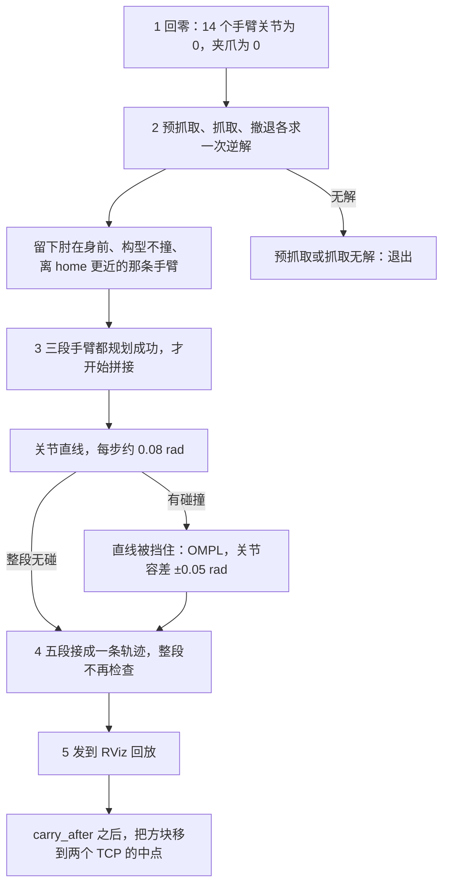
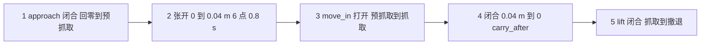

# 桌面抓取的拼接轨迹

本文按 [scene_gento_skye.py](scene_gento_skye.py) 当前的 `main()` 说明整段抓取动画怎么拼出来，以及每一段的验证边界。这次用哪个规划器见 [grasp_planner_recommendation.md](grasp_planner_recommendation.md)。碰撞网格、跳过的对和仍要查的对见 [grasp_collision.md](grasp_collision.md)。规划组、允许碰撞矩阵和关节空间扩展见 [RRT 教程](../tutorials/RRT.md) 与 [SRDF 说明](srdf.md)。

> **结论：** 动画由三段选中手臂的规划和两段直接插入的夹爪插值组成。三段手臂路径各自做过离散碰撞检查。两段夹爪开闭、三段之间的接头、方块随手移动，以及整段拼接后的轨迹，都没有再做一次完整碰撞验证。当前结果用于 RViz 显示和模型回放。

## 1. 先求关节角，再交给 OMPL

笛卡尔位姿只进 KDL。KDL 把它解成关节角之后，OMPL 只在关节空间里找一条不碰撞的路。两次调用之间，位姿已经不在规划请求里。OMPL 不读位姿，也不调用 KDL。逆解失败，这一段规划不会开始。求解器内部的循环见 [kdl_ompl.md](../tutorials/kdl_ompl.md)。

当前 `main()` 里，预抓取、抓取、撤退各走一遍：

1. `solve_side()` 调用 `solve_ik()`，向 `/compute_ik` 要关节解。`kinematics.yaml` 指定的求解器是 `kdl_kinematics_plugin/KDLKinematicsPlugin`。选中的手臂是 7 个关节角。`avoid_collisions` 设为 false。姿态锁死时超时 250 ms，否则 80 ms。
2. `elbow_in_front()` 用 `/compute_fk` 丢掉肘在身后的解。`goal_is_valid()` 用 `/check_state_validity` 丢掉已经撞上桌面或方块的构型。`choose_arm()` 留下离 home 关节距离更近的那条手臂，规划组是 `right_arm` 或 `left_arm`。另一条手臂停在 0。
3. `plan_between()` 先做 `interpolated_motion()`：关节空间直线，每步约 0.08 rad，逐步调用 `/check_state_validity`。整段无碰就直接当轨迹，不再进 OMPL。
4. 直线被挡住，才调用 `plan_group()`，向 `/plan_kinematic_path` 发关节目标。每个关节是一条 `JointConstraint`，位置是上一步留下的关节角，容差 ±0.05 rad。`pipeline_id` 是 `ompl`，`planner_id` 是 `--planner`，默认 `RRTConnect`。夹爪开度写在起始状态里，不参与搜索；夹爪网格仍参与碰撞。

`plan_gento_skye.py` 的目标已经是关节角，只走第 4 步。RViz 里目标是位姿标记时，MoveIt 在同一次 `plan()` 里自己做逆解和规划；目标直接是关节角时，没有逆解这一步。

从回零到回放，整段是：

三段手臂都走「直线，挡住才 OMPL」这个分支。夹爪张开和闭合不进这个分支。撤退逆解失败，或 `lift` 规划失败时，脚本先从场景里删掉方块再规划一次。逆解本身失败时，撤退目标写成抓取关节角，不再重新求逆解。

## 2. 五段按什么顺序接在一起

脚本先用 `reset_to_home()` 发布回零状态：14 个手臂关节为 0，夹爪为闭合 `0`。这是模型状态重置，不是从原状态规划回零路径。随后尝试为预抓取、抓取和撤退求逆解；前两者失败就退出，撤退失败则进入后述回退。只有手臂规划全部返回可用结果，才按下面的顺序拼接动画，并不是执行完一段后再规划下一段。

各段时间以第一段为基准累加。`take_segment()` 只加上上一段的结束时刻，不额外留过渡时间；如果新段首点的局部时间是 0，它就与上一段末点同一时刻，不能说时间戳始终严格递增。

| 顺序 | 代码 | 搜索变量 | 手臂名义起终点 | 夹爪 | 这一段有没有调用规划 |
|---|---|---|---|---|---|
| 1 | `approach` | 选中手臂的 7 个关节 | 回零 → 预抓取关节角 | 固定闭合，0 m | 先关节直线；挡住才 `ompl` |
| 2 | `ramp_grippers()` | 无 | 停在上一段最后一个点 | 0 → 0.04 m | 无，插入 6 个点，时长 0.8 s |
| 3 | `move_in` | 选中手臂的 7 个关节 | 预抓取关节角 → 抓取关节角 | 固定打开，0.04 m | 先关节直线；挡住才 `ompl` |
| 4 | `ramp_grippers()` | 无 | 停在上一段最后一个点 | 0.04 m → 0 | 无，插入 6 个点，时长 0.8 s |
| 5 | `lift` | 选中手臂的 7 个关节 | 抓取关节角 → 撤退关节角 | 固定闭合，0 m | 先关节直线；挡住才 `ompl` |

`take_segment()` 把每段规划结果里的夹爪位置改写成该段的固定开度，再接到上一段的结束时刻。`install_trajectory()` 把这五段点列放回同一个 `JointTrajectory`，关节名是左右臂 14 个关节加上四个夹爪关节。

这里的 0.04 m 是每个主动指爪关节的平移量，不是夹口总宽。左右夹爪各有一个主动关节和一个 mimic 从动关节，所以写入四个关节不等于四个独立自由度。0 表示脚本定义的闭合位置，不代表已经夹住方块。

`solve_pair()` 先求右臂，再以右臂解作为左臂逆解状态的一部分，采用第一组通过 `goal_is_valid()` 的组合。下表是 `main()` 显式传入的候选位置，不是文件顶部的默认 `PREGRASP`；单位是米，坐标系是 `base_link`。

| 阶段 | 右臂候选 TCP | 左臂候选 TCP | 状态检查时的夹爪 |
|---|---|---|---|
| 预抓取 | (0.70, −0.24, 0.55)，(0.62, −0.26, 0.58) | (0.70, 0.24, 0.55)，(0.62, 0.26, 0.58) | 闭合 |
| 抓取 | (0.70, −0.14, 0.62)，(0.68, −0.16, 0.64) | (0.70, 0.14, 0.62)，(0.68, 0.16, 0.64) | 打开 |
| 撤退 | (0.52, −0.12, 0.72)，(0.48, −0.16, 0.78) | (0.52, 0.12, 0.72)，(0.48, 0.16, 0.78) | 闭合 |

表中“状态检查时的夹爪”仅指最终 `goal_is_valid()`。`solve_ik()` 把 `avoid_collisions` 设为 false，并筛掉不满足 `elbow_in_front()` 的解；碰撞留到 `goal_is_valid()`。之后才按表中的开闭值复核。它还会枚举 TCP 姿态，每次调用默认最多收集两个解，可能在第一个位置就达到上限，因此没有穷尽表内所有位置与姿态。找不到解不能直接断言这些目标都不可达。

规划请求里每个目标关节的容差是 ±0.05 rad，约 ±2.9°。所选规划器（默认 `RRTConnect`）的目标是这个关节范围，不是笛卡尔点本身，也不是“离目标小于 `range`”。`move_in` 和 `lift` 都是关节空间规划，没有要求 TCP 沿直线接近或竖直抬起，也没有要求沿途保持逆解时的 TCP 姿态。

## 3. 每一段实际检查到哪里

### 3.1 `approach`

请求起点里两条手臂都是 0，搜索变量是 `choose_arm()` 留下的那 7 个关节，夹爪在规划状态里保持 0。目标是预抓取关节角。直线被挡住时，MoveIt 沿这条手臂路径做离散碰撞检查：夹爪网格以闭合状态随手臂运动，检查桌板、底板、桌腿、球、方块，以及当前允许碰撞矩阵（ACM，由 SRDF 初始化）中仍启用的自碰撞对。检查范围受该规划组及其受影响连杆限制，不等于重新检查全机器人所有碰撞对。腰、头和轮组不在搜索变量里，未指定的状态沿用规划场景中的当前值。另一条手臂停在 0。

这一段不包含随后的张开。

### 3.2 第一次 `ramp_grippers()`

四个夹爪关节从 0 线性变到 0.04 m。默认 0.8 秒、6 个点，手臂关节复制上一段最后一个点，位置不变。函数只写 `JointTrajectoryPoint`，不调用 `/plan_kinematic_path`，也不调用 `/check_state_validity`。

因此张开过程没有沿途碰撞检查。指爪在张开时仍可能碰到桌板、方块或另一只手。6 个点只决定回放有多密，不表示这 6 个状态已经验证。

### 3.3 `move_in`

规划状态把夹爪固定为 0.04 m，从名义预抓取关节角规划到抓取关节角。碰撞检查与 `approach` 相同，只是夹爪网格使用打开宽度。

请求写入的起点是逆解得到的 `pregrasp`，不是 `approach` 轨迹的实际最后一个点。因为目标容差是 ±0.05 rad，上一段实际终点可以落在名义预抓取附近，而不等于这次使用的起点。

### 3.4 第二次 `ramp_grippers()`

与第一次相同，方向相反：0.04 m 到 0，0.8 秒，6 个点，手臂不动。闭合过程同样没有碰撞检查。闭合时指爪可能夹到方块，也可能扫到桌面或另一只手；这些接触都没有在这一段里被接受或拒绝。

`carry_after` 记在这段结束的时刻。回放条件是 `time_from_start >= carry_after`，所以闭合的最后一个点就会触发第一次移动方块，而不是等到下一个撤退点。

### 3.5 `lift`

夹爪固定为 0，从名义抓取关节角规划到撤退关节角。成功时，检查的是闭合夹爪下的手臂路径，场景里仍然有方块。

若撤退逆解失败，或这次规划失败，脚本请求从 PlanningScene 删除 `cube` 再规划一次。逆解本身失败时，不会在删除方块后重新求逆解，而是令 `retreat = grasp`：起点和目标都是名义抓取关节角。即使返回成功，也不能称为完成了抬升或撤退。重试返回之后，脚本请求把方块加回原位置 `(0.70, 0, 0.39)`。因此，在场景更新成功的前提下，有两种成功：

- 第一次成功：方块还在场景里。
- 第二次成功：规划时场景里没有方块。不能把这次成功说成原场景下的撤退也通过了。

这里的删除和恢复都没有检查 `ApplyPlanningScene` 响应的 `success`；调用返回不等于场景更新已成功。代码也没有用 `try/finally` 保证异常或超时时恢复方块。`plan_group()` 只把错误码为成功且至少有两个轨迹点的响应视为可用结果，并不验证末端确实抬升。

## 4. 拼接之后没有再查一遍

五段点列接成一条轨迹后，脚本不再对整条点列调用碰撞检查或时间参数化。三个手臂请求都指定速度、加速度缩放 0.25；当前 [OMPL 配置](../gento_skye_moveit_config/config/ompl_planning.yaml) 包含 `AddTimeOptimalParameterization`，用于处理各段规划结果。插入的夹爪点是均匀时间上的关节位置线性插值，没有经过这个适配器。

`take_segment()` 通过 `point_at()` 重建点时只保留位置和时间，原来的 `velocities`、`accelerations` 等字段没有复制。因此，保留各段时间戳不等于保留了完整的速度、加速度轨迹，更不能证明拼接后的运动满足所有限制。

段与段的接头包括：

- `approach` 的实际终点到 `move_in` 的实际首点。中间只插入了夹爪张开，但下一段请求仍使用名义 `pregrasp`。
- `move_in` 的实际终点到 `lift` 的实际首点。中间是夹爪闭合，但下一段请求仍使用名义 `grasp`。

±0.05 rad 是每个关节的目标容差，不是 14 维关节向量的总误差上限，也不是接头差值的无条件上限。当前配置含起点修正适配器，下一段实际首点也应从返回结果核对，不能只看请求中的名义起点。

这些接头没有单独做碰撞检查或连续性检查。若新段首点局部时间为 0，就会把不同位置写在同一时间戳上；即使位置完全相同，也仍有重复时间戳，脚本没有去重。仅增加一点时间不能代替连接路径验证和时间参数化。

## 5. 回放里的方块不是被规划的物体

`show()` 把拼接轨迹发到 `/display_planned_path`。`play_on_model()` 按时间戳逐点把关节角发到 `/joint_states`，让 RViz 里的模型跟着动；它没有在相邻点之间自行插值。同步 FK 和场景更新服务调用也可能使回放落后于计划时间，因此这不是实时轨迹控制器。

从 `carry_after` 对应点起，每个回放点用正运动学读两个 TCP；若两个 FK 都成功，就用 `CollisionObject.MOVE` 请求把世界中的 `cube` 移到两个 TCP 的中点，姿态设为单位四元数。这不是 `AttachedCollisionObject`，没有保存手与方块之间的固定相对位姿，也没有检查 MOVE 响应的 `success`。规划 `lift` 时，方块仍在桌面上的原位，或者在失败回退里曾被临时删除。搬运过程中方块与桌子、球、手臂和夹爪的碰撞没有作为附着物体检查过。也没有设置 `touch_links` 来允许手指接触方块。

“抓取”只是阶段名称，不是已经接触物体的证明。方块中心是 `(0.70, 0, 0.39)`、边长 0.06 m，而名义抓取 TCP 的高度是 0.62 或 0.64 m，两 TCP 的横向间距为 0.28～0.32 m。这些数值必须结合 TCP 到指尖的变换和指爪几何核对，不能仅凭关节状态无碰撞就认定夹住了方块。第一次把方块移到 TCP 中点可能造成明显位置跳变。

双臂同时抓住一块方块所需要的相对位姿约束也没有写进规划请求。三段手臂规划都只有各自的关节目标，没有闭链抓持约束；即使把目标容差缩到零，也不能保证闭合后两只手沿途共同保持抓持。

## 6. 这不是真机轨迹

回放停在 RViz 模型。脚本不向真机控制器发送 `FollowJointTrajectory`。[demo.launch.py](../gento_skye_moveit_config/launch/demo.launch.py) 没有启动真机轨迹控制器，[moveit_controllers.yaml](../gento_skye_moveit_config/config/moveit_controllers.yaml) 也没有控制器清单和 action 映射，因此没有把这条拼接轨迹接到 Gento Skye 的执行链路。apex 中的 OmniPicker 驱动使用协议字节，不是这里的 0 到 0.04 m 指爪关节量，两者需要明确标定和映射。

## 7. 若要把它变成完整验证的抓取

当前代码停在演示。建议按下面的依赖顺序改造，而不是再删一次方块。这是后续实现步骤，不是当前脚本已经具备的能力。

1. **先核对模型、场景和抓取几何。** 校准 TCP、指尖接触面、夹爪行程及方块位姿，基于物体坐标系生成两手抓取位姿、预抓取偏移和撤退方向。确认各次场景更新成功，并以完整、同步的机器人状态开始；若需回零，单独规划和验证回零路径，不能用模型状态跳变替代。
2. **规划到预抓取。** 可以保留当前“闭合接近、到预抓取后张开”的顺序，但必须验证预抓取处有足够张开空间。记录返回轨迹的实际终点和完整状态，后续步骤都从该状态继续；逆解搜索与目标复核使用的夹爪状态应与对应阶段一致。
3. **张开夹爪并检查整个运动。** 手臂保持实际终点，按主动关节行程生成开爪轨迹并更新 mimic 关节；检查关节限位、插值区间及碰撞。检查范围必须覆盖运动的指爪和相关机器人连杆，不能仅凭六个未验证的显示点接受该段。
4. **规划进入抓取位姿。** 从实际张开后的完整状态出发，方块仍作为世界碰撞体。若任务要求直线接近或固定姿态，应显式采用相应笛卡尔路径或路径约束，并核对实际终点的抓取几何；选中手臂的普通关节目标不提供这些保证。
5. **闭合并确认抓持。** 闭合期间仅对预期的指尖—方块接触对按阶段设置 ACM，仍检查其余碰撞；夹爪按物体尺寸和接触策略停止，不是无条件插到 0。真机还需位置、力或其他反馈确认抓持，允许接触不等于证明抓持稳定。
6. **附着方块后再规划撤退。** 在闭合后的实际状态，把方块从世界物体转换为附着到一个选定手部连杆的碰撞体，保留当时的手—物体相对位姿，并设置最小必要的 `touch_links`。同一方块不应重复附着到两只手；第二只手通过规划器实际支持的相对位姿／闭链约束保持抓持，并沿途验证。确认场景转换成功后再规划携物撤退，检查附着方块与环境及非接触连杆的碰撞。失败时停止或重新求解，不能删除方块后把无物体规划视为抓取成功。
7. **整理时间并验证最终结果。** 相邻段的实际边界必须一致；只有状态一致时才能合并重复边界点，否则应规划并验证连接段。为手臂和夹爪配置有效的速度、加速度限制，保留必要停顿，对最终运动重新分配时间并检查严格递增的时间戳、速度与加速度连续性。随后按各阶段正确的 ACM、世界／附着状态和实际执行插值检查整条轨迹及点间区间，而不是只查离散输出点；记录检查分辨率，不能把离散检查等同于连续碰撞保证。
8. **最后接入执行链路。** 明确手臂控制器的关节清单、action 映射和插值方式，以及主动／mimic 关节的处理和夹爪协议标定。按“手臂到位 → 开闭爪反馈 → 附着状态更新 → 携物运动”同步执行，再在受控条件下低速验证，并配置故障停止与恢复流程。

在这些步骤完成之前，三段手臂路径的检查结论只适用于各自规划时的场景、夹爪状态和检查设置；它们不能自动延伸为对拼接动画或真机抓取的完整验证。
