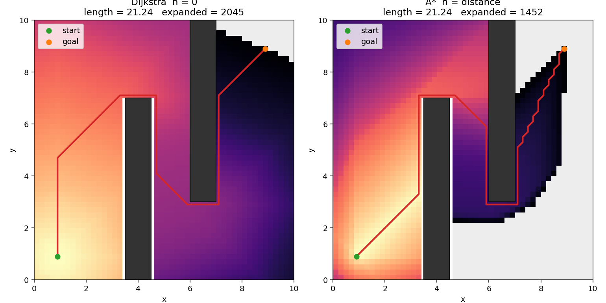
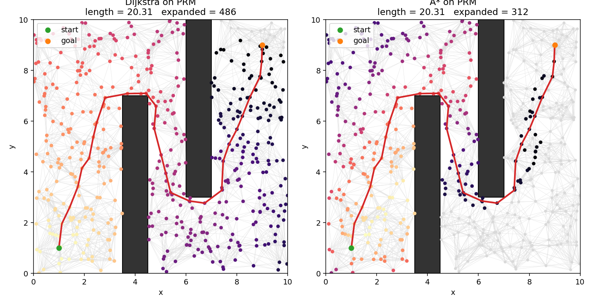

# 从零学习采样规划

配套代码是同目录的 `planners_2d.py`。先读一节，再跑对应的图，然后只改一个参数看图怎么变。`scene_gento_skye.py` 里那 14 个 `--planner` 名字的说明在 [`tutorials/README.md`](tutorials/README.md)。机器是平面上的一个点，地图是 $[0,10]\times[0,10]$，两面错开的墙迫使路径绕行。

```bash
cd motion_planning_from_scratch
python planners_2d.py          # 下面表格里的图都会生成
python planners_2d.py rrt
python planners_2d.py rrt_connect
python planners_2d.py prm
python planners_2d.py search
python planners_2d.py rrt_star
python planners_2d.py ompl     # 没装 OMPL 的 Python 绑定时会跳过
```

种子是固定的：RRT 用 0，RRTConnect 用 1，PRM 用 2，RRT* 用 3。RRT* 按墙钟时间停，所以最后一位长度会有微小差别。下面的数字来自一次实际运行，图就在这个目录里。

| 运行 | 结果 |
|---|---|
| RRT | 533 次采样，347 个节点，路径长 26.08，见 `rrt.png` |
| RRTConnect | 490 次采样，两棵树共 229 个节点，路径长 26.31，见 `rrt_connect.png` |
| PRM 第一次查询 | 500 个路网点加上起终点，路径长 20.31 |
| PRM 第二次查询 | 路网不重建，只多接两个点，路径长 12.39，见 `prm.png` |
| 网格上的 Dijkstra / A* | 路径都长 21.24。Dijkstra 展开 2045/2115 格，A* 展开 1452/2115 格。见 `search_grid.png` |
| PRM 上的 Dijkstra / A* | 路径都长 20.31。Dijkstra 展开 486/502 点，A* 展开 312/502 点。见 `search_prm.png` |
| RRT* | 约 0.17 s 出现第一条路，长约 27.6；5 s 时降到约 20.2。见 `rrt_star.png`、`rrt_star_cost.png` |

直线距离是 $\|(9,9)-(1,1)\| = 8\sqrt{2} \approx 11.31$。障碍让任何可行路径都长于这个数。RRT 找到的 26 只是「能走」，RRT* 把同一类路径收到 20 附近，并且 5 秒结束时曲线还在往下掉。

---

## 1. 问题到底在求什么

工作空间在这个练习里就是构型空间，因为机器人是一个点：

$$
\mathcal{C} = [0,10]\times[0,10] \subset \mathbb{R}^2.
$$

障碍是闭矩形 $\mathcal{C}_{\mathrm{obs}}$。自由空间是它的补集

$$
\mathcal{C}_{\mathrm{free}} = \mathcal{C}\setminus \mathcal{C}_{\mathrm{obs}}.
$$

一次规划给定 $q_{\mathrm{start}}, q_{\mathrm{goal}}\in\mathcal{C}_{\mathrm{free}}$，要找一条连续曲线

$$
\sigma:[0,1]\to\mathcal{C}_{\mathrm{free}},\qquad
\sigma(0)=q_{\mathrm{start}},\quad \sigma(1)=q_{\mathrm{goal}}.
$$

代价取曲线长度。折线路径 $q_0,q_1,\ldots,q_m$ 的长度是

$$
L = \sum_{i=0}^{m-1}\|q_{i+1}-q_i\|_2,
\qquad
\|q\|_2 = \sqrt{x^2+y^2}.
$$

代码里的 `dist` 和 `path_length` 就是这两个式子。

采样规划不直接求 $\sigma$。它在 $\mathcal{C}$ 里抽点，只把不碰撞的局部运动留成图的边，再在图上找一条从起点到终点的通路。算法之间的差别是：图是树还是路网，找到一条就停还是继续把 $L$ 变小，碰撞检测是立刻做还是等这条边进入候选路径再做。

机械臂上同一套式子仍然成立，只是 $q\in\mathbb{R}^7$ 是七个关节角，$\|q_a-q_b\|$ 是关节空间距离，不再是末端在桌子上走了多远。MoveIt 的 `group.plan()` 就是在那个高维 $\mathcal{C}_{\mathrm{free}}$ 里做这件事。

这两块障碍的面积是 $1\times 7 + 1\times 7 = 14$，所以

$$
\mu(\mathcal{C}_{\mathrm{free}}) = 100-14 = 86.
$$

`free_area()` 返回这个数。后面 RRT* 的半径要用它。

---

## 2. 碰撞检测

点 $q=(x,y)$ 落在闭矩形 $[x_{\min},x_{\max}]\times[y_{\min},y_{\max}]$ 内，当且仅当四个不等式同时成立：

$$
x_{\min}\le x\le x_{\max},\qquad y_{\min}\le y\le y_{\max}.
$$

线段不能只查两个端点。记

$$
q(t) = a + t(b-a),\qquad t\in[0,1],\qquad dx=b_x-a_x,\ dy=b_y-a_y.
$$

整段都在矩形内，等价于存在 $t\in[0,1]$ 使 $q(t)$ 满足上面四个不等式。整理成 $p_i t \le q_i$：

$$
\begin{align*}
-dx\, t &\le a_x-x_{\min},\\
 dx\, t &\le x_{\max}-a_x,\\
-dy\, t &\le a_y-y_{\min},\\
 dy\, t &\le y_{\max}-a_y.
\end{align*}
$$

于是

$$
p = (-dx,\ dx,\ -dy,\ dy),\qquad
q_{\mathrm{coef}} = (a_x-x_{\min},\ x_{\max}-a_x,\ a_y-y_{\min},\ y_{\max}-a_y).
$$

从 $t_0=0$、$t_1=1$ 开始，对每一对 $(p_i, q_i)$：

- $p_i=0$：线段与这条边平行。若 $q_i<0$，整条线在矩形外侧，不相交。
- $p_i<0$：不等式给出下界 $t\ge q_i/p_i$。用它抬高 $t_0$。若新下界已经大于 $t_1$，区间空了。
- $p_i>0$：给出上界 $t\le q_i/p_i$。用它压低 $t_1$。

最后 $t_0\le t_1$ 才相交。这就是 `segment_hits_rect`。点或线段碰了任意一块障碍，或者跑出 $[0,10]^2$，就算不在 $\mathcal{C}_{\mathrm{free}}$ 里。

地图是凸的，两个端点都在地图内时，线段不会穿出边界，所以边界不用再剪一次。

---

## 3. 最近邻和 steer

树上（或路网里）离随机点最近的节点是

$$
q_{\mathrm{near}} = \arg\min_{q\in V}\|q_{\mathrm{rand}}-q\|_2.
$$

`nearest` 把这个最小值线性扫一遍。节点数是 $n$ 时，每次查询是 $O(n)$，长 $n$ 步的总时间和 $n^2$ 成正比。OMPL 用 kd-tree 一类的结构把单次查询降到大约 $O(\log n)$。二维教学代码故意不用它，这样循环体和公式一一对应。

steer 把一步的长度限制成 $\eta$。代码里 $\eta=0.5$。

$$
q_{\mathrm{new}} =
\begin{cases}
q_{\mathrm{rand}} & \text{若 }\|q_{\mathrm{rand}}-q_{\mathrm{near}}\|\le\eta,\\[4pt]
q_{\mathrm{near}} + \eta\dfrac{q_{\mathrm{rand}}-q_{\mathrm{near}}}{\|q_{\mathrm{rand}}-q_{\mathrm{near}}\|} & \text{否则.}
\end{cases}
$$

第二行是从 $q_{\mathrm{near}}$ 出发、方向指向 $q_{\mathrm{rand}}$、长度恰好为 $\eta$ 的点。随机点可以落在障碍里：它只提供方向，真正要加入图的是 $q_{\mathrm{new}}$，并且线段 $\overline{q_{\mathrm{near}}q_{\mathrm{new}}}$ 必须整段在 $\mathcal{C}_{\mathrm{free}}$ 里。

---

## 4. RRT

RRT 从起点长一棵树。第 $k$ 次循环做三件事，对应 `rrt()` 里的那几行：

1. 在整个 $\mathcal{C}$ 上均匀抽 $q_{\mathrm{rand}}$。障碍里也抽。这是原始 RRT，不是只在自由空间里抽。
2. 找 $q_{\mathrm{near}}$。
3. 用 steer 得到 $q_{\mathrm{new}}$。线段不碰障碍才把 $q_{\mathrm{new}}$ 收进树，父节点记成 $q_{\mathrm{near}}$。

父节点下标存在 `parents` 里。从终点顺着父节点走回 $-1$，再反转，就是一条路径。`trace_path` 做的就是这个。

终点不会被随机点刚好抽中。所以另加一条停止规则：若

$$
\|q_{\mathrm{new}}-q_{\mathrm{goal}}\|\le\eta
$$

并且 $\overline{q_{\mathrm{new}}q_{\mathrm{goal}}}$ 无碰，就把终点接到 $q_{\mathrm{new}}$ 上，算法停。这仍然是「可行即可」。树的其他分支全部留下，下一次规划不复用。

LaValle 的写法把第 3 步叫 `EXTEND`，返回值有三个：

- Trapped：这一步碰到障碍，树不变。
- Advanced：收下了一个新点，但还没到达采样点。
- Reached：新点就是采样点（距离不超过 $\eta$ 时 steer 会直接走到采样点）。

`Tree.extend` 按这个约定返回。

这次运行在第 533 次循环停住，路径长 26.08。图上的折线是锯齿，因为每一步只保证无碰，不保证短。把 `ETA` 改成 0.2 再跑，树会更密，路径通常更碎，迭代次数变多。

概率完备性可以先记成一句话：只要存在一条与障碍有正间隙的路径，采样次数趋于无穷时，RRT 失败的概率趋于 0。它不保证这条路径接近最短。

目标偏置是后来加上的实用改动，基础 RRT 没有用。以概率 $p$ 把 $q_{\mathrm{rand}}$ 直接设成终点，树会被拉向目标。RRT* 那一节用了 $p=0.05$，因为优化器要在时间上限里先找到一条路。

---

## 5. RRTConnect

维护两棵树。$T_a$ 从起点长，$T_b$ 从终点长。每一轮：

1. 抽一个 $q_{\mathrm{rand}}$，对 $T_a$ 做一次 `EXTEND`。
2. 如果没有 Trapped，就对 $T_b$ 做 `CONNECT`：朝刚刚得到的 $q_{\mathrm{new}}$ 反复 `EXTEND`，直到 Reached 或 Trapped。
3. 交换 $T_a$ 和 $T_b$，下一轮从另一边长。

`CONNECT` 不是只走一步。只要方向还通，它就把步长 $\eta$ 用满，所以中间那一段常常是一条直线。两棵树接上的时候，路径是

$$
\text{起点} \leadsto \text{汇合点} \leadsto \text{终点}.
$$

汇合点在两棵树里各有一个坐标相同的节点，拼接时去掉一个，避免重复。`rrt_connect` 用 `a_is_start` 记住哪一棵树的根才是起点，因为每一轮都交换。

和单向 RRT 比，空旷区域里要探索的体积小很多：每棵树只负责一半路程。MoveIt 里的 `RRTConnectkConfigDefault` 就是这个算法，状态空间从 $\mathbb{R}^2$ 换成关节空间。

这次图里蓝色从终点长出，粉色从起点长出，在两面墙之间接上，长度 26.31。它和 RRT 一样，找到就停，所以不会比 RRT 更「优」，只是通常更早找到。

---

## 6. PRM，然后做一次图搜索

PRM 把建图和查询分开。

建图与起终点无关。在 $\mathcal{C}_{\mathrm{free}}$ 里拒绝采样 $N$ 个点（抽到障碍就丢掉，再抽），代码里 $N=500$。对每个点取 $k$ 个最近邻，$k=15$。线段无碰才连边。边权是欧氏长度

$$
w(u,v) = \|u-v\|_2.
$$

图是无向的：$u$ 连上 $v$ 时，$v$ 的邻接表里也写上 $u$。一个点最后的度数可以大于 $k$，因为别的点也会选中它。

查询时才把 $q_{\mathrm{start}}$ 和 $q_{\mathrm{goal}}$ 加进去，各自连向当前路网的 $k$ 个近邻。然后在这张带权图上做最短路搜索。Dijkstra 和 A* 的公式、以及为什么 RRT 的树不用这一步，在下一节。代码入口是 `graph_search`。

第二次查询用 $(1,9)\to(9,1)$。`prm_build` 的结果不丢，`prm_attach` 只把两个新点接上。节点数从 502 变成 504（500 个采样点加上两对起终点）。这就是它和 RRT 的差别：树在目标一变时整个作废，路网留着。

本次第一次路径长 20.31，第二次 12.39。第二次更短，是因为这对起终点的几何路程本来就更短，不是路网突然变好了。

近邻个数有一个充分条件。维数 $d=2$ 时，

$$
k(n) > e\left(1+\frac{1}{d}\right)\ln n
= e\cdot 1.5\cdot\ln n.
$$

$n=500$ 时右边大约是 25。这里用的 $k=15$ 小于这个充分条件，但这张图上两次查询都连通了。充分条件不是必要条件。如果把障碍加厚之后出现「路网断成两块」，把 `k` 提到 $\lceil e(1+1/d)\ln N\rceil$ 再看。

环境一变，旧边可能穿进新障碍。那时要么重建，要么用 LazyPRM：边先假定能走，Dijkstra 选出候选路径之后只检查这条路径上的边，撞了就删掉再搜。

---

## 7. Dijkstra 和 A*

RRT 长出来的是树：每个新点只有一个父节点。从任意点走回起点，父指针只有一条路，没有别的路可选。`trace_path` 就是顺着这条指针走。所以树状规划器找到终点就可以停，中间不存在「在一张网里挑一条最短路」这个问题。

PRM 的路网不是树。一个点连着 $k$ 个邻居，图里有环，从起点到终点的路径有很多条。建图只回答「哪些点之间能直接走」，不回答「该走哪一条」。后一个问题是图搜索。

网格也是同一类问题。`grid_graph` 把这张地图切成边长 0.2 的格子，八连通，对角步不允许从障碍角上切过去。格子中心之间的边权仍是欧氏长度。网格和路网的差别只是节点怎么来的：一个是规则切出来的，一个是随机撒出来的。搜索公式相同。

### 两个数

$g(u)$ 是从起点走到 $u$ 的已知最小代价。起点 $g(s)=0$，没见过的点是 $+\infty$。

$h(u)$ 是从 $u$ 走到终点还要多少代价的估计，不看图，只看几何。搜索用的排序键是

$$
f(u) = g(u) + h(u).
$$

每次从堆里取出 $f$ 最小的点 $u$。对它的每条边 $(u,v)$ 做松弛：

$$
\text{若 } g(u)+w(u,v) < g(v),\quad
\text{则 } g(v)\leftarrow g(u)+w(u,v),\ \mathrm{prev}(v)\leftarrow u,
$$

并把 $v$ 以新的 $f(v)$ 放回堆。`prev` 记的是「目前最短的那条路从谁走过来」。搜完之后从终点顺着 `prev` 走回起点，和 RRT 的 `trace_path` 是同一件事。差别在于这些父节点是从已有的边里挑出来的，不是采样时当场长出来的。

边权非负时，有两种取 $h$ 的方式。

Dijkstra 取 $h(u)=0$，所以 $f=g$。它按「离起点的真实代价」从近到远往外扩。一个点被取出时，$g(u)$ 已经是最短路长度：任何还没取出的点，代价都不会更小，而边权又不能是负的，后面不可能找到更便宜的走法。

A* 取

$$
h(u) = \|q_u - q_{\mathrm{goal}}\|_2.
$$

直线是平面上最短的剩余路程。图上的路还要绕障碍，只会更长，所以这个 $h$ 不会高估，叫做可采纳（admissible）：

$$
h(u) \le h^{*}(u),
$$

$h^{*}$ 是 $u$ 到终点的真实最短路。它还满足一致性（consistent）：

$$
h(u) \le w(u,v) + h(v).
$$

欧氏距离的三角不等式就是这行。一致性能推出可采纳。此时和 Dijkstra 一样，一个点第一次被取出，$g(u)$ 就定稿了，终点第一次被取出时路径就是最短的。`graph_search` 对这两种 $h$ 是同一个函数，`dijkstra` 传入常数 0，`astar` 传入到终点的距离。

### 这次图上的差别

`python planners_2d.py search` 生成下面两张图。颜色是取出顺序：黄的早，紫的晚，灰的或白的是没看过。红线是搜出来的路径。

| 图 | Dijkstra | A* | 路径长度 |
|---|---|---|---|
| 0.2 网格，2115 个自由格 | 取出 2045 | 取出 1452 | 都是 21.24 |
| PRM，种子 2，502 个点 | 取出 486 | 取出 312 | 都是 20.31 |



左图几乎把自由格子填满，波前按离起点的路程往外推，右上角最后才被涂上。右图的右上、右下留着一块没搜过的区域：那些格子的 $f=g+h$ 已经大于终点这条路的 $f$，堆里轮不到。两条红线长度都是 21.24。格子上的折线更碎，是因为八连通只能走水平、垂直和对角。



灰点是没被取出的路网点，灰线是建图时就存在、但搜索没走到的边。两边红线都长 20.31，和上一节同一种子的 PRM 第一次查询相同。A* 没有找到另一条更短的路，它少做的是展开：502 个点里 Dijkstra 取出 486 个，A* 取出 312 个。右上角那一团灰点离起点并不远，只是背离终点，$h$ 把它们排到了后面。

网格上的 21.24 比路网上的 20.31 长，是因为格子不能走 PRM 里那条任意方向的斜边。

### 启发式一旦高估，最短就没了

可采纳是最优性的条件，不是 A* 这个循环自带的。三个点就能看出来：

$$
S \xrightarrow{1} A \xrightarrow{1} G,
\qquad
S \xrightarrow{3} G.
$$

最短路长度是 2。若令 $h(A)=1000$，$h(S)=h(G)=0$，则 $h(A)$ 大于 A 到 G 的真实代价 1。取出顺序是：

- 先取出 $S$。$A$ 的 $f=1+1000=1001$，直连到 $G$ 的 $f=3+0=3$。
- 下一步取出 $G$，路径是 $S\to G$，长度 3。算法在终点被取出时停，不会再回去看 $A$。

Dijkstra（$h=0$）会先展开 $A$，把 $G$ 的代价从 3 改成 2，再取出 $G$。`self_check` 里断言了这两个长度。把权重加成 $h(u)=w\|q_u-q_{\mathrm{goal}}\|$ 且 $w>1$，是同一种破坏：展开更少，路径可能变长。MoveIt 的默认最短路查询用的是可采纳这一档，不会故意把 $w$ 加大。

RRT* 里的 $\mathrm{Cost}(q)$ 就是这里的 $g(q)$。它看起来也在做松弛，但边是边采样边出现的，所以要 rewire。Dijkstra 和 A* 假定图已经固定。

---

## 8. RRT*

RRT* 的树仍然从起点长，采样和 steer 与 RRT 相同。多出来的是父节点选择和 rewire。代价是从起点沿树走过来的长度

$$
\mathrm{Cost}(q_{\mathrm{start}})=0,\qquad
\mathrm{Cost}(q)=\mathrm{Cost}(\mathrm{parent}(q))+\|q-\mathrm{parent}(q)\|.
$$

### 连接半径

第 $n$ 个节点加入时，邻域半径是

$$
r(n)=\min\left\{\gamma\left(\frac{\ln n}{n}\right)^{1/d},\,\eta\right\}.
$$

二维单位圆面积 $\zeta_2=\pi$。定理要求

$$
\gamma > \gamma^{*}
= 2\left(1+\frac{1}{d}\right)^{1/d}
\left(\frac{\mu(\mathcal{C}_{\mathrm{free}})}{\zeta_d}\right)^{1/d}.
$$

把 $d=2$、$\mu=86$ 代进去：

$$
\gamma^{*}
= 2\sqrt{1.5}\sqrt{\frac{86}{\pi}}
\approx 2\times 1.2247\times 5.232
\approx 12.82.
$$

代码取 $\gamma=1.1\gamma^{*}\approx 14.10$，并且 $d=2$，所以

$$
r(n)=\min\left(14.10\sqrt{\frac{\ln n}{n}},\ 0.5\right).
$$

半径写成 $(\ln n / n)^{1/d}$ 的原因可以用体积数出来，常数 2 则属于证明。一个半径 $r$ 的球体积是 $\zeta_d r^d$。$n$ 个点撒在体积 $\mu$ 的自由空间里时，若希望每个点的球里大约有 $\ln n$ 个别的点，就有

$$
n\cdot\frac{\zeta_d r^d}{\mu}\approx \ln n
\qquad\Rightarrow\qquad
r \approx \left(\frac{\mu}{\zeta_d}\right)^{1/d}\left(\frac{\ln n}{n}\right)^{1/d}.
$$

定理把前面的系数放大到 $\gamma^{*}$，得到的是渐近最优的充分条件，不只是连通。证明见 Karaman 和 Frazzoli 2011，第一节课不必推。

和 $\eta$ 取最小，是因为我们的局部运动最长只有一步。理论上的 $r(n)$ 在 $n$ 还小的时候比 0.5 大，截断之后邻域就是「一步之内」。$r(n)$ 降到 0.5 以下大约要 $n\approx 7000$。这次 5 秒只长到大约 2900 个节点，所以打印出来的 `radius` 仍然是 0.500。把 `time_limit` 再加大，才能看到半径开始收缩。

也有用近邻个数代替半径的版本：$k(n)>e(1+1/d)\ln n$。OMPL 的 RRT* 内部用的是半径形式，`setRange` 对应这里的 $\eta$。

### 选父节点

steer 得到无碰的 $q_{\mathrm{new}}$ 之后，收集

$$
Q_{\mathrm{near}}=\{q\in V:\|q-q_{\mathrm{new}}\|\le r(n),\ \overline{q\,q_{\mathrm{new}}}\subset\mathcal{C}_{\mathrm{free}}\}.
$$

父节点不是最近节点，而是近邻里「走到新点的总代价」最小的那个：

$$
q_{\mathrm{parent}}
= \arg\min_{q\in Q_{\mathrm{near}}\cup\{q_{\mathrm{nearest}}\}}
\mathrm{Cost}(q)+\|q_{\mathrm{new}}-q\|.
$$

最近节点单独并进来，是因为一步的长度可能正好等于 $\eta$，而 $r(n)<\eta$ 时它会落在球的外面。这一步已经做过碰撞检测。

### rewire

新点写进树之后，对每个近邻检查：从新点绕过去是否更短。

$$
\text{若 }
\mathrm{Cost}(q_{\mathrm{new}})+\|q-q_{\mathrm{new}}\| < \mathrm{Cost}(q)
\text{ 且线段无碰，}
$$

就把 $q$ 的父节点改成 $q_{\mathrm{new}}$。改完必须把以 $q$ 为根的整棵子树的代价重算，否则子孙还记着旧的 $\mathrm{Cost}$，后面的比较会错，甚至把树连成环。`rewire_parent` 先改父子关系，再沿着 `children` 往下更新。

终点不放进随机树里，单独记一条最好的接入：

$$
\mathrm{Cost}(q_{\mathrm{goal}})
= \min_i \mathrm{Cost}(q_i)+\|q_{\mathrm{goal}}-q_i\|,
$$

其中 $i$ 跑过能无碰连到终点、并且距离不超过当前 $r(n)$ 的节点。某次 rewire 把接入点的代价降低了，接入代价要跟着刷新。

### 为什么它会把 planning_time 用完

RRT 在第一次接到终点时返回。RRT* 的停止条件是时间（或迭代次数），不是「找到了」。多出来的时间都花在换父节点和 rewire 上，$L$ 只减不增。

这次种子 3、`goal_bias=0.05`：

- 0.1 秒时还没有可行路径。
- 大约 0.17 秒出现第一条，长度约 27.6，和普通 RRT 的 26 同一量级。
- 之后有八十多次改进。5 秒时大约 20.2，接近这张图上 PRM 的 20.3。
- 曲线在 4 秒之后仍在下降，只是越来越慢。

所以 MoveIt 里如果规划器是 `RRTstarkConfigDefault`，`set_planning_time(5.0)` 不是「最多等 5 秒、找到就走」，而是优化器会把这 5 秒用来磨短路径。点到点要快，用 RRTConnect，把时间收到 0.1 秒量级。

---

## 9. 用 OMPL 跑同一张图

OMPL 不改变上面的定义。它接受一个状态空间、一个「这个状态是否在 $\mathcal{C}_{\mathrm{free}}$ 里」的函数，以及起终点，然后调用某一个 `geometric` 规划器。

`demo_ompl()` 把状态空间设成二维盒子 $[0,10]^2$，有效性函数就是 `collides_point` 的否定，`setRange(ETA)` 对应步长 $\eta$。然后分别构造 `og.RRTConnect` 和 `og.RRTstar`。

两条实现不会画出同一条折线。采样序列不同，OMPL 对线段的碰撞是沿边按分辨率抽点，这里是第 2 节的精确矩形判别。要对照的是行为：

- RRTConnect 很快给出一条偏长的路。
- RRT* 在同样的时间上限里继续把长度往下压。

这一步对上之后，再看 MoveIt。`group.set_pose_target` 先做逆解，得到关节空间里的 $q_{\mathrm{goal}}$。`group.plan()` 在 $\mathbb{R}^{n_{\mathrm{dof}}}$ 里调用你刚写过的那一类规划器。`request_adapters` 里的时间参数化是规划之后的事：几何路径 $\sigma(s)$ 已经有了，再配上 $s(t)$，使速度和加速度不超限。几何规划器本身不产生时间。

当前环境没有 `from ompl import base` 这个 Python 模块，所以脚本会打印一句跳过。MoveIt 的 C++ 库是同一套算法。绑定装好之后，直接 `python planners_2d.py ompl`，图写到 `ompl.png`。

---

## 10. 优化器和笛卡尔轨迹

这三类都不是「再长一棵树」。采样规划已经能跑通之后再看。

### CHOMP

给定一条离散轨迹，把中间路点堆成一个大向量 $\xi$。起点和终点固定。要减小的目标大致是

$$
U(\xi) = f_{\mathrm{obs}}(\xi) + \lambda f_{\mathrm{smooth}}(\xi).
$$

平滑项用来罚速度或加速度。用一阶或二阶差分矩阵 $K$ 写成

$$
f_{\mathrm{smooth}}(\xi)=\frac12\|K\xi\|^2,
\qquad
\nabla f_{\mathrm{smooth}} = K^{\top}K\,\xi.
$$

障碍项看工作空间里的距离 $d(x)$。常用的截断代价是：间隙小于 $\varepsilon$ 时才惩罚，例如

$$
c(x)=
\begin{cases}
(\varepsilon-d(x))^2 & d(x)<\varepsilon,\\
0 & \text{否则.}
\end{cases}
$$

点机器人上 $x=q$。机械臂上要先做正向运动学，再用雅可比把工作空间里的梯度送回关节空间。代价还要乘上这一段的步长，

$$
f_{\mathrm{obs}} \approx \sum_t c(q_t)\,\|q_{t+1}-q_t\|,
$$

否则优化器会在碰撞的那一段把速度拉得很大，用很少的路点「冲过去」，采样点看起来碰得少，实际轨迹仍然擦到障碍。

梯度下降如果直接用 $\nabla U$，每个路点各自移动，轨迹会起皱。CHOMP 用平滑矩阵当度量：

$$
M = K^{\top}K,
\qquad
\xi \leftarrow \xi - \eta\, M^{-1}\nabla U(\xi).
$$

$M^{-1}$ 把「这个路点被障碍推开」扩散成一整段平滑的弯曲。字母 C 指的就是这个协变（按 $M$ 度量的最速下降），不是又一个采样技巧。

它需要一条初始轨迹。初值可以是直线，也可以是 RRTConnect 的结果。初值穿进很深的障碍，或者场景非凸时，它会停在一个很差的局部结果里。它没有 RRT 那种「时间够长就以概率 1 找到路」的保证。

### STOMP

同样优化一条已有轨迹，但不求 $\nabla h$。设 $R=M^{-1}$，抽 $K$ 条平滑噪声

$$
\varepsilon_k \sim \mathcal{N}(0, R),\qquad \xi_k = \xi+\varepsilon_k.
$$

噪声协方差取 $M^{-1}$，是为了让扰动本身就是平滑的，而不是每个路点独立抖动。每条轨迹有标量代价 $h(\xi_k)$（碰撞、长度、约束都可以写进 $h$，不要求可导）。权重

$$
p_k = \frac{\exp(-h(\xi_k)/\lambda)}{\sum_j \exp(-h(\xi_j)/\lambda)},
\qquad
\xi \leftarrow \xi + \sum_k p_k\varepsilon_k.
$$

代价低的噪声权重大，更新是这些噪声的加权平均。硬碰撞这种不可导代价可以直接用。要调的是噪声尺度、温度 $\lambda$ 和迭代次数，同样可能停在局部结果里。

MoveIt 可以把 RRTConnect 的输出交给 STOMP 或 CHOMP 做后处理。那是「先找一条可行几何路径，再磨光滑」，不是从零开始长树。

### Pilz 的 LIN 和 compute_cartesian_path

这两条不做随机搜索。末端位置沿直线走参数 $s\in[0,1]$：

$$
p(s) = (1-s)\,p_{\mathrm{start}} + s\,p_{\mathrm{goal}}.
$$

姿态用四元数球面插值。设 $q_0,q_1$ 为单位四元数，$\Omega=\arccos(q_0\cdot q_1)$，则

$$
q(s)
= \frac{\sin((1-s)\Omega)}{\sin\Omega}\,q_0
+ \frac{\sin(s\Omega)}{\sin\Omega}\,q_1.
$$

$\Omega$ 接近 0 时退化为普通线性插值。时间律 $s(t)$ 用梯形速度：加速度不超过 $a_{\max}$，速度不超过 $v_{\max}$。路程 $L$ 足够长时，先加速 $t_a=v_{\max}/a_{\max}$，中间匀速，再对称减速。加速段走过的距离是 $\tfrac12 a_{\max}t_a^2$。若 $L$ 太短，还没到 $v_{\max}$ 就要减速，峰值速度改成 $\sqrt{a_{\max} L}$。

每个 $s_i$ 上的位姿再做逆解，得到关节路点。逆解失败或关节路径碰障，LIN 就失败。`compute_cartesian_path` 是同一件事的另一个入口：按末端步长 $\Delta$ 前进，每步逆解并做碰撞检测，返回实际走完的比例。

摇杆每次只挪 1 cm 时，用的应是这一节，而不是第 4 节的 RRT。周围空旷、步长又短，直线加逆解没有采样可做。

### control::RRT 为什么先跳过

几何规划假定 $\mathcal{C}_{\mathrm{free}}$ 里两个状态之间可以走直线。这个假定对「只限制关节角、速度稍后单独参数化」的机械臂成立。

如果系统是 $\dot x = f(x,u)$，两个状态之间未必存在直线运动。control 规划器改为抽一个控制 $u$，把动力学积分一小段

$$
x_{\mathrm{new}} = x + \int_{0}^{\Delta t} f(x(t), u)\,dt,
$$

再把 $x_{\mathrm{new}}$ 接到树上。MoveIt 规划 Franka 的点到点轨迹时不走这条路径。

---

## 11. 对照着读

代码里的函数能指到论文的哪一段时再读。证明可以后补。

1. Dijkstra，1959，*A Note on Two Problems in Connexion with Graphs*。对照 `graph_search` 在 $h=0$ 时的松弛。A* 是 Hart、Nilsson、Raphael，1968，*A Formal Basis for the Heuristic Determination of Minimum Cost Paths*。对照 $h(u)=\|q_u-q_{\mathrm{goal}}\|$ 以及「高估就失去最优」那三个点。
2. LaValle，《Planning Algorithms》第 5 章，以及 1998 年的 RRT 技术报告。对照 `rrt` 和 `Tree.extend`。书在 <http://lavalle.pl/planning/>。
3. Kavraki, Švestka, Latombe, Overmars，1996，*Probabilistic Roadmaps for Path Planning in High-Dimensional Configuration Spaces*。对照 `prm_build`、`prm_attach`。
4. Kuffner, LaValle，2000，*RRT-Connect*。对照 `Tree.connect` 里「EXTEND 失败才停、否则一直走到目标点」的循环，以及每轮结束都交换两棵树。
5. Karaman, Frazzoli，2011，*Sampling-based Algorithms for Optimal Motion Planning*。只看 RRT* 的父节点选择、rewire 和 $r(n)$。渐近最优的证明放后面。
6. Şucan, Moll, Kavraki，2012，*The Open Motion Planning Library*。看它怎么把状态空间、碰撞检测和规划器拆开。这就是 `demo_ompl` 那几行在库里的位置。
7. 采样部分已经能改参数、能预测图会怎么变之后，再读 Zucker 等人的 CHOMP 和 Kalakrishnan 等人的 STOMP。

建议的改法，每次只动一处：

- `ETA` 从 0.5 改成 0.2，看 RRT 的树和迭代次数。
- `rrt_connect` 的 `max_iter` 调小，直到失败，再看两棵树停在墙的哪一边。
- PRM 的 `k` 改成 3，看路网会不会断开；再改成 25，看边变密、查询变短。
- `demo_rrt_star` 的 `time_limit` 改成 0.2 和 5.0，对比 `rrt_star_cost.png`。这就是 `set_planning_time` 在优化型规划器上的含义。
