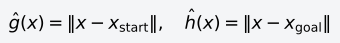
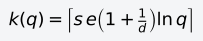
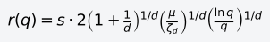
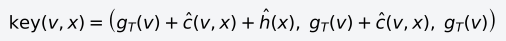

# BITstar

[返回目录](README.md)。随点数增长的近邻个数见 [PRMstar.md](PRMstar.md)，边采样边 rewire 见 [RRTstar.md](RRTstar.md)。批次会随椭球面积变化的写法见 [FITstar](KPIECE_BKPIECE_LBKPIECE_SBL_EST_TRRT_BiTRRT_AnytimePathShortening_FITstar.md#fitstar)。

BIT*（Batch Informed Trees，Gammell、Barfoot、Srinivasa，IJRR 2020；会议版是 ICRA 2015）每轮加一批样本，把它们看成一张还没做碰撞检测的随机几何图，再按「这条边有没有可能改短当前解」的顺序去查边。OMPL 的名字是 `BITstar`。本仓库的 `--planner` 列表里没有它。

## 一批样本

默认 `samples_per_batch = 100`。还没有解时，样本在关节限位盒子里均匀抽，状态本身碰了障碍就丢掉。已经有一条代价 c_best 的路之后，新样本只从还能改短它的集合里抽。路径长度下，启发式是

满足 ĝ(x)+ĥ(x) < c_best 的点才留下。这是以起点、终点为焦点、长轴为 c_best 的椭球。直线距离 c_min = ‖q_start − q_goal‖。c_best 越靠近 c_min，后面的样本越集中在还能把关节折线改短的地方。边的下界是 ĉ(v, x) = ‖v − x‖。

## 近邻

默认 `use_k_nearest = true`。参与当前这张图的样本数是 q 时，近邻个数是

s 是 `rewire_factor`，默认 1.1，要求大于 1，近邻个数才严格落在 Karaman、Frazzoli 的渐近最优下界外面。q = 1000 时，d = 7 的 k = 24，d = 14 的 k = 23。和 [PRMstar](PRMstar.md) 一样，k 随维数略减。剪枝打开时（默认开着），解变短之后 q 只数留在椭球里的点。

关掉 k 近邻才用半径。半径是同一篇论文里的 r_rrg* 再乘 s：

μ 一开始是关节限位盒子的体积。剪枝之后改成当前知情集合的体积。即时采样默认关着，而且只在半径模式里有意义。

## 边队列

半径或 k 之内的点对都算有一条候选边，碰撞检测推迟到这条边被选中。边队列用三元组做字典序：

g_T(v) 是树上从起点走到 v 的真实代价。第一项是「走这条边再去终点」的下界，后两项只用来打破平局。

每一轮，若最好的顶点展开值不差于最好的边，就把该顶点邻域里下界仍小于 c_best、并且可能降低目标点代价的边放进队列。然后弹出最好的边。下界已经不小于 c_best，这条边直接丢掉。否则做一次线段碰撞检测。无碰，并且 g_T(v) + c(v, x) 更小，就把 x 的父节点改成 v。x 是新点就进树；已经在树上就是 rewire，子树代价跟着改。

队列里没有还能改短当前解的边时，这一批结束。剪枝丢掉不可能改进 c_best 的样本和顶点。代价和知情集合的体积都要比上次剪枝时至少小 0.05，才真正剪，避免解只短了一点点就重建近邻。然后抽下一批，重新展开。

找到第一条路之后不返回。时间用完，或者解已经等于启发式下界 c_min，才停。代价只降不升。

[RRTstar](RRTstar.md) 每个新点都把半径里的近邻查一遍，时间花在这些线段上。BIT* 把检测集中在队列认为有希望的边上。一批结束再加一批，有解之后样本缩进椭球。七轴上累计约 1000 个样本时默认 k = 24，双臂是 23，近邻个数落在 e(1+1/d) ln q 这一档。点到点要快，用 [RRTConnect](RRTConnect.md)。愿意把时间用来换更短的关节路径时，BIT* 和 RRTstar 是同一类：`--time` 是用来磨短的预算。
