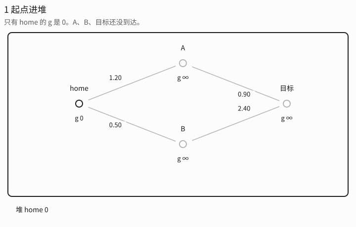
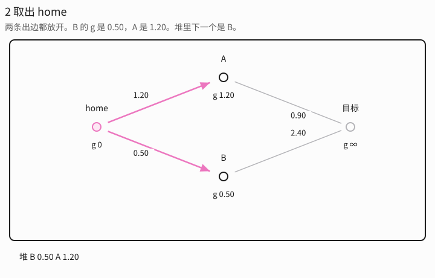
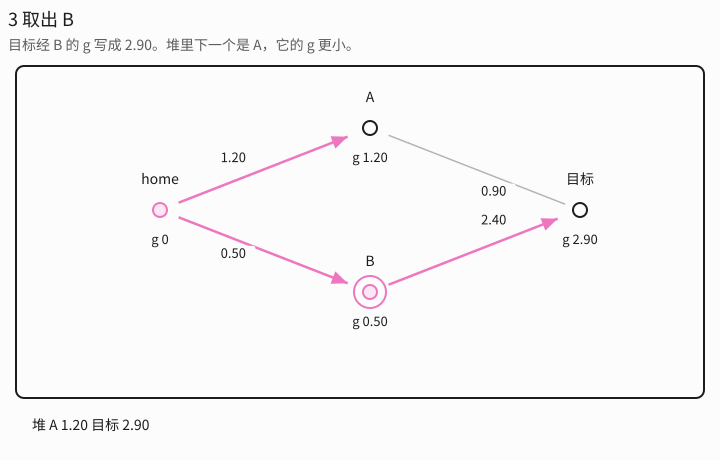
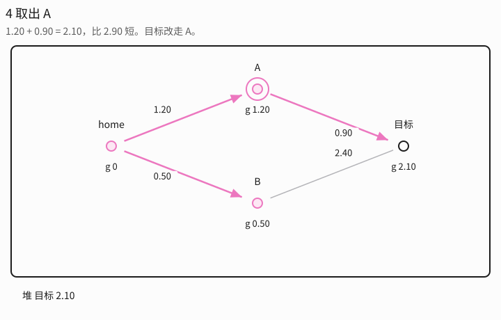
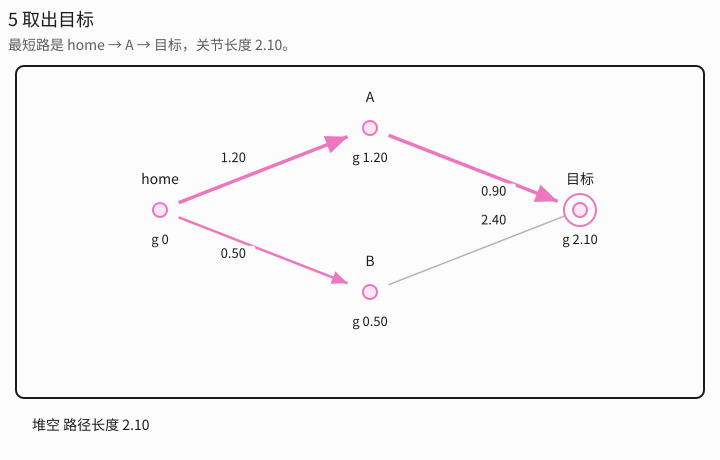
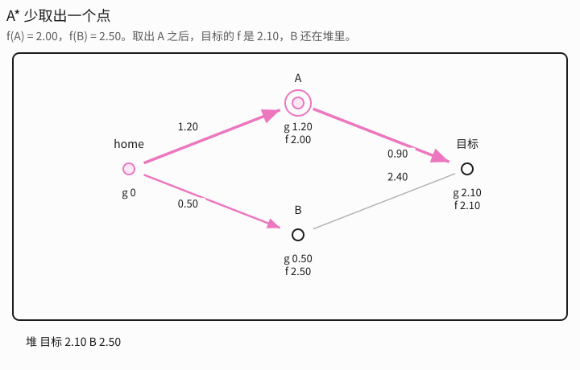

# Dijkstra 和 A*

[返回目录](README.md)。二维网格和路网上的取出次数在 [`planning_from_scratch.md`](../docs/planning_from_scratch.md) 第 7 节，函数是 `graph_search`、`dijkstra`、`astar`。下面写在 Gento Skye 的 PRM 路网上。建图见 [PRM](PRM.md)。

这一步发生在建图之后。里程碑已经是选中那条手臂的 7 个关节角，边已经是查过碰撞的关节直线，边权是关节长度。搜索不再移动手臂，也不再做碰撞检查，只在这些边里挑一条从 home 到抓取逆解的最短链。

[RRT](RRT.md) 的树不用这一步。每个点只有一个父节点，顺着父指针走回去只有一条路。路网有环，从 home 到预抓取可以有很多条。OMPL 的 `PRM` 用 A* 做这次挑选。Dijkstra 是同一段循环里启发式取 0 的情形。

## 两个数

`g(u)` 是从起点沿着已经定下来的边走到 u 的最小关节长度。起点 `g(home) = 0`。还没走到的里程碑是正无穷。

`h(u)` 是从 u 再到目标还要多少关节长度的估计。它不看路网，也不看桌子和球，只看两个关节角有多远。

排序用的是

`f(u) = g(u) + h(u)`

每次从堆里取出 f 最小的里程碑 u。对它的每条边 (u, v)：

若 `g(u) + w(u, v) < g(v)`，就把 `g(v)` 改成这个更小的值，并记下 `prev(v) = u`。v 以新的 f 放回堆。

`prev` 记的是「目前最短的那条路从谁走过来」。目标被取出之后，从目标顺着 `prev` 走回 home，得到关节路径。这些父节点是从已经建好的边里挑的。RRT 的父节点是采样时当场长出来的。

边权都是关节长度，不会是负数。

## Dijkstra

Dijkstra 取 `h(u) = 0`，所以 `f = g`。它按「从 home 走过来的真实关节长度」从近到远往外扩。

一个里程碑被取出时，`g(u)` 已经定稿。还在堆里的点，代价都不会更小。边权又不能是负的，后面不可能找到更便宜的走法。

在这台手臂上，先被展开的是关节路径上离 home 近的里程碑。TCP 已经飘到球后面、但关节上绕了远路的点，g 大，排在后面。目标第一次被取出时，那条链就是这张网上的最短关节路径。

下面这组数是示意，不是某次规划的日志。边权是关节长度。粉边是当前的 `prev`，圈住的点是这一步取出的里程碑。灰边还在图上，这一步没有把它当成父边。

| 边 | 关节长度 | 点 | 到目标的 h |
|---|---|---|---|
| home → A | 1.20 | A | 0.80 |
| home → B | 0.50 | B | 2.00 |
| A → 目标 | 0.90 | 目标 | 0 |
| B → 目标 | 2.40 | | |

开始时只有 home 的 g 是 0。A、B、目标还没到达。

取出 home。两条出边都放开：B 的 g 写成 0.50，A 写成 1.20。堆按 g 排序，下一个是 B。

取出 B。目标经 B 的 g 写成 0.50 + 2.40 = 2.90。堆里 A 的 g 是 1.20，比 2.90 小，所以下一个取出 A。

取出 A。1.20 + 0.90 = 2.10，小于目标现在的 2.90，目标改走 A。B 已经定稿，它的 g 留在 0.50。

取出目标。g = 2.10 定稿。顺着 `prev` 走回去是 home → A → 目标。经 B 的 2.90 还在图上，不在这条路上。

### 从 home 加出去

[`planning_from_scratch.md`](../docs/planning_from_scratch.md) 第 7 节、种子 2 的平面路网有 502 个点：500 个采样，再加上 home (1, 1) 和目标 (9, 9)。每个点最多连 15 个不撞墙的近邻。点号是这次采样的下标，home 是 500，目标是 501。下面的路程是这张平面图上的长度。Dijkstra 取出 486 个点后停。

home 的路程是 0，连着 15 条边。第 1 次取出 home，这 15 个邻居各自写成那一条边的长度。最短的五条是：

| 邻居 | 这条边 | 写上的路程 |
|---|---|---|
| 10 | 0.085 | 0.085 |
| 34 | 0.438 | 0.438 |
| 309 | 0.464 | 0.464 |
| 99 | 0.521 | 0.521 |
| 461 | 0.598 | 0.598 |

其余 10 条更长，最长的一条到点 76，长度 0.965。

第 2 次拿堆里最小的，点 10，路程 0.085。点 10 再连出去，新点的路程是 0.085 加上那条新边。这些新点里最小的是点 433：0.085 + 0.924 = 1.009。

拿出的点留着。它的路程已经定稿，后面用它给还没定稿的邻居写数。已经写过、还没拿出的点也留在堆里。下一次拿的是堆里剩下的最小路程。

第 2 次之后，点 10 新写下的数都至少是 1.009。堆里更小的仍是 home 写下的点 34，路程 0.438，比下一条 home 的边 0.464 小。第 3 次拿点 34。

同一个点可以被改短。点 57 被写过三次：

1. 从点 10 过去：0.085 + 1.014 = 1.099
2. 从点 34 过去：0.438 + 0.545 = 0.983
3. 从点 17 过去：0.614 + 0.357 = 0.971

0.971 最小，所以留下来。第 17 次取出点 57 时，链是 home → 点 17 → 点 57。

第 4 次到第 16 次仍是 home 直接连着的点，按边长从小到大。每次也会写下更远的新点，那些新点的路程都比 0.965 大，先排着：

| 第几次 | 拿出的点 | 路程 |
|---|---|---|
| 4 | 309 | 0.464 |
| 5 | 99 | 0.521 |
| 6 | 461 | 0.598 |
| 7 | 225 | 0.600 |
| 8 | 17 | 0.614 |
| 9 | 471 | 0.675 |
| 10 | 129 | 0.689 |
| 11 | 197 | 0.756 |
| 12 | 345 | 0.762 |
| 13 | 313 | 0.866 |
| 14 | 93 | 0.883 |
| 15 | 43 | 0.921 |
| 16 | 76 | 0.965 |

home 的 15 个邻居拿完以后，堆里最小的是点 57，路程 0.971。第 18 次是点 433，路程 1.009，链是 home → 点 10 → 点 433。

再往后还是拿堆里剩下的最小路程。链变长，路程从 1 加到 20.31：

| 第几次 | 拿出的点 | 路程 | 从 home 走几步 |
|---|---|---|---|
| 19 | 2 | 1.031 | 2 步：home → 10 → 2 |
| 30 | 168 | 1.332 | 2 步：home → 471 → 168 |
| 50 | 415 | 1.998 | 4 步 |
| 100 | 376 | 4.280 | 6 步 |
| 200 | 340 | 8.564 | 9 步 |
| 300 | 151 | 13.908 | 18 步 |
| 400 | 394 | 16.487 | 21 步 |
| 486 | 目标 | 20.315 | 27 步 |

第 486 次拿出的是目标。答案沿着 `prev` 走回去，每一步都是上一个点的路程再加一条边。边长写到四位，路程是这些四位边长相加：

| 走到 | 加上 | 路程 |
|---|---|---|
| home | | 0 |
| 76 | 0.9648 | 0.9648 |
| 491 | 0.7164 | 1.6812 |
| 460 | 0.8705 | 2.5517 |
| 396 | 0.7485 | 3.3002 |
| 187 | 0.4852 | 3.7854 |
| 337 | 0.8495 | 4.6349 |
| 267 | 0.5887 | 5.2236 |
| 156 | 1.0310 | 6.2546 |
| 357 | 0.8941 | 7.1487 |
| 124 | 0.7353 | 7.8840 |
| 133 | 0.6348 | 8.5188 |
| 215 | 0.8813 | 9.4001 |
| 367 | 1.0791 | 10.4792 |
| 344 | 0.7490 | 11.2282 |
| 284 | 0.7828 | 12.0110 |
| 39 | 0.8056 | 12.8166 |
| 223 | 0.6062 | 13.4228 |
| 353 | 0.8676 | 14.2904 |
| 379 | 0.0880 | 14.3784 |
| 195 | 1.0494 | 15.4278 |
| 315 | 0.7066 | 16.1344 |
| 354 | 0.6635 | 16.7979 |
| 271 | 0.5589 | 17.3568 |
| 240 | 0.8087 | 18.1655 |
| 7 | 0.9008 | 19.0663 |
| 19 | 0.5998 | 19.6661 |
| 目标 | 0.6486 | 20.3147 |

加完是 20.3147，第 7 节写成 20.31。这条链上有 28 个点。另外取出的点留着各自的路程。还有 16 个点没有被取出，它们的路程在 20.34 到 21.25 之间，留在堆里。

## A*

A* 取

`h(u) = ‖q_u − q_goal‖`

这是 u 到查询时接上的那个目标构型的关节距离。目标落在逆解的 ±0.05 rad 里。它不是指尖到方块的米数。一组关节角离抓取逆解很近，h 就小，哪怕肘在桌面上的位置看起来还差一截。

关节空间的直线距离不会高估剩余路程。图上的路要绕开球和桌板，边权加起来只会更长，所以

`h(u) ≤ h*(u)`

`h*` 是 u 沿路网走到目标的真实最短关节长度。这种 h 叫做可采纳。它还满足一致性：

`h(u) ≤ w(u, v) + h(v)`

这是欧氏距离的三角不等式。一致的 h 一定可采纳。此时和一个点在 Dijkstra 里一样：里程碑第一次被取出，`g(u)` 就定稿。目标第一次被取出，路径就是这张网上的最短路。

可采纳时，A* 和 Dijkstra 选出同一条关节路径。A* 少做的是取出。关节上背离抓取逆解的里程碑，h 把它们的 f 抬高，堆里轮不到。

同一张图上，f(A) = 1.20 + 0.80 = 2.00，f(B) = 0.50 + 2.00 = 2.50。取出 home 之后下一步是 A。取出 A 之后，目标的 f = 2.10，比 B 的 2.50 小，下一步取出目标。B 留在堆里。路径仍是 home → A → 目标，长度仍是 2.10。

## 估计一旦高估

可采纳是最短路还在的条件。三个点就能看出来：home 到 A 的边权 1，A 到目标的边权 1，home 直接到目标的边权 3。最短路长度是 2。

若令 h(A) = 1000，h(home) = h(目标) = 0，则 A 的 f = 1001，直连目标的 f = 3。先取出 home，下一步取出目标，路径长度 3。算法在目标被取出时停，不会再回去看 A。

Dijkstra 的 h 全是 0，会先展开 A，把目标的代价从 3 改成 2，再取出目标。把启发式加成 `h(u) = w ‖q_u − q_goal‖` 并且 w > 1，是同一种放大：取出更少，关节路径可能变长。OMPL 这条查询用的是到目标的关节距离，w = 1，停在可采纳这一档。

## 和 RRT* 的代价

[RRT*](RRTstar.md) 里的 `Cost(q)` 就是这里的 `g(q)`。它也在做同一种放宽：经过新点更短，就改父节点。RRT* 的边是边采样边出现的，所以要 rewire。Dijkstra 和 A* 开始时，路网已经固定，没有新边再插进来。

搜完的折线还没有时间。`AddTimeOptimalParameterization` 再按关节速度、加速度上限给每个点写 `time_from_start`。搜索比较的是关节长度。

路网在窄缝处断成两块时，两条算法都到不了目标。那是建图没有连通，不是堆排错了。一次抓取只要尽快有一条能走的路，查询这一步不会发生，直接用 [RRTConnect](RRTConnect.md)。
