# KPIECE、BKPIECE、LBKPIECE、SBL、EST、TRRT、BiTRRT、AnytimePathShortening、FITstar

[返回目录](README.md)。哪五个值得先掌握见 [prominent.md](prominent.md)。取舍见 [pros_cons.md](pros_cons.md)。

下面这些仍是 [RRT](RRT.md) 那一轮循环，或包在它外面。OMPL 改的是往哪扩、何时做碰撞检查，或在已经找到的路径上再缩短。点到点仍用 [RRTConnect](RRTConnect.md)。

| 改法 | 名字 |
|---|---|
| 低维投影决定往哪扩，或把碰撞检查推迟到候选路径 | [KPIECE](#kpiece)、[BKPIECE](#bkpiece)、[LBKPIECE](#lbkpiece)、[SBL](#sbl) |
| 优先往稀疏区域扩 | [EST](#est) |
| 拒绝走进高代价区域 | [TRRT](#trrt)、[BiTRRT](#bitrrt) |
| 包在别的规划器外面，持续把路径缩短 | [AnytimePathShortening](#anytimepathshortening) |
| 知情树的一种变体 | [FITstar](#fitstar) |

## 投影和推迟检查

这一组用低维投影决定往哪扩，或者把碰撞检查推迟到一条候选路径上。碰撞检测很贵、死胡同很多时，省下的是那些不会出现在答案里的线段。投影把通道压扁时，树会去扩别处。

默认没指定投影时，实向量空间用前两个分量。七轴手臂上这通常是靠近基座的两个关节，不是末端在桌子上的位置。投影相同的两个构型，其余关节可以差很远。格子只用来挑选下一步从哪长，碰撞检测仍在完整关节空间里做。

### KPIECE

KPIECE（Kinodynamic Planning by Interior-Exterior Cell Exploration，Şucan、Kavraki，WAFR 2008）用一层投影格子引导一棵树。OMPL 的几何实现是 `KPIECE1`：格子只有一层，画在状态空间的投影上。双向版本是 [BKPIECE](#bkpiece)，懒检查版本是 [LBKPIECE](#lbkpiece)。

维数 n 的投影里，一个格子的正交邻居最多 2n 个。对角邻居不算。正交邻居少于 2n 个，这个格子就是边界格（external），否则是内部格。二维投影上，上下左右四个邻居都有节点时，它才是内部格。地图边缘的格子永远凑不齐四个邻居，所以一旦被占领就一直算边界。

每个格子保存落在里面的运动。OMPL 里覆盖度 `coverage` 每加入一段运动加 1。`selections` 是这个格子被挑中扩张的次数，新建时设为 1。新建格子的分数是

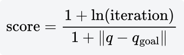

`iteration` 是这棵树已经扩张了多少轮，分母用新点到目标的距离，离目标近的新格子分数更高。重要性是

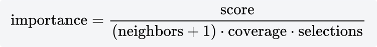

覆盖低、被选次数少、正交邻居少的格子，重要性高。

每一轮以概率

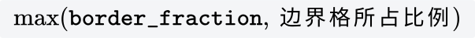

在边界格里挑重要性最高的一格，否则在内部格里挑。`border_fraction` 默认 0.9。若 95% 的格子已经在边界上，即使参数是 0.9，选中边界的概率也是 95%。空的那一侧不存在时就退回另一侧。

挑中之后 `selections` 加 1，再在这个格子的运动里抽一个当父节点。OMPL 用半正态整数，下标小的（更早加入的）运动更容易被抽到。

分数因多次失败乘到接近 0 时，OMPL 给每个格子加上 1+ln(iteration)，避免重要性全成 0。

以概率 `goal_bias`（默认 0.05）把采样点设成目标，否则在父节点周围半径 `range` 的球里均匀抽。然后检查这段运动。

整段无碰就收下。整段碰了，但从父节点量起、无碰的那一截占原运动的比例大于 `min_valid_path_fraction`（默认 0.2），就留下这一截，树可以贴着障碍往前爬。连这一截都不够，扩张失败，该格子的分数乘上 `failed_expansion_score_factor`（默认 0.5），下一轮它没那么容易再被选中。

目标偏置抽到的是目标点本身，这段可以比 `range` 长。失败同样乘 0.5。在障碍后面反复把目标当采样点，会把当前格子的分数打下去。

`--planner KPIECE` 是单向的，找到进入目标的运动就停。格子活在二维投影上，14 维的 `both_arms` 也能长，因为启发式不在 14 维体积里均匀撒点。投影把一条窄通道压成已经「内部」的格子时，树会去扩别处，通道要等边界分数重新升上来才被再试。

### BKPIECE

BKPIECE 是双向的 KPIECE。OMPL 的类名是 `BKPIECE1`。起点一棵树，终点一棵树，各有自己的投影格子。每一轮换一棵树做和 KPIECE 相同的扩张：按边界比例挑格子，在 `range` 球里采样，整段无碰或有效前缀足够长才收下。失败时那个格子的 `score` 乘以 `failed_expansion_score_factor`（与 KPIECE 相同，默认 0.5）。

新运动写进自己的格子之后，用同一个投影坐标去另一棵树的格子里找。那个格子里有运动的话，随机挑一个，再对这两点之间的线段做一次碰撞检测。无碰就把两棵树接上。

拼接时要分清这一轮长的是哪一棵树。从起点树长出来的运动，路径是「起点树走到新点，再从对方那个点走回终点」。从终点树长出来时，两段对调。OMPL 的实现先把「当前是不是起点树」这个布尔量翻转，再用翻转后的值决定要不要对调；路径的几何结果就是上面这一句。

和 [RRTConnect](RRTConnect.md) 的差别在连接条件。RRTConnect 在关节空间里朝新点一直 `CONNECT`，两棵树的节点可以在任意位置汇合。BKPIECE 只在投影落进同一格时才试一次连接。格子大，容易试到一段很长、其实穿墙的桥；格子小，两棵树要在投影上贴得很近才开始试。

和 [SBL](#sbl) 的差别在检查时机。BKPIECE 的边在加入时就检查，树里没有未验证的边。SBL 先收下，等候选路径出现再查。

`--planner BKPIECE` 找到就停。没有目标偏置参数：终点树的根就是目标，不需要再把目标当采样点。`both_arms` 上它和 KPIECE 一样依赖投影。投影合理、场景又大时，两棵树各自只填一半，通常比单向 KPIECE 快。

### LBKPIECE

LBKPIECE（Lazy BKPIECE）把 [SBL](#sbl) 的推迟检查套到 BKPIECE 的两棵树上。OMPL 的类名是 `LBKPIECE1`。

每一轮仍按 KPIECE 的重要性挑一个格子、一个父节点，再在 `range` 球里抽一个新状态。这里用的是普通状态采样器，新状态可以落在障碍里。边不检查，节点直接进树。根节点标记为已经验证。

投影坐标在另一棵树里已经有节点时，随机挑一个，把那个状态复制成桥，桥也不检查。然后从桥的两端走回各自的根，只查还没标记为真的边：

- 无碰：标成真。
- 碰了：删掉这个节点和全部后代。若从父节点量起的无碰前缀占这段运动的比例大于 `min_valid_path_fraction`，把前缀末端再插回去，并标成真。树不会因为一次碰墙把已经走过的那一截全部丢掉。

两条回溯都通过才返回路径。

它没有 `failed_expansion_score_factor`。扩张当时不知道失败，分数不会因为碰墙而减半。坏边要等它被卷进一条候选路径才暴露，然后连同子树一起删掉。

碰撞检测因此集中在「有希望连上」的那几条路径上。树在这之前会含有穿墙的节点，画出来不能把每一条边都当成能走。

`--planner LBKPIECE` 找到就停。检测很贵、投影又把两棵树很快拉到同一带区域时，它比 BKPIECE 少做很多线段检查。投影把通道判错时，它会反复生成桥、再删掉，时间花在删除而不是扩展上。这种场景换 [RRTConnect](RRTConnect.md)。

### SBL

SBL（Single-query Bidirectional Lazy planner，Sánchez、Latombe，2002）是一次查询、双向、碰撞检查推迟的树。OMPL 的 `geometric::SBL` 用投影格子估计密度。

每个格子的抽样权重是

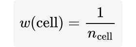

n_cell 是这个格子里的节点数。按权重抽一个格子，再在格子里均匀抽一个节点。空格子权重高，树会被拉向还没放进几个点的投影区域。

两棵树，一棵从起点，一棵从终点，轮流长。从抽中的节点出发，在半径 `range` 里抽一个新状态。OMPL 用的是有效状态采样器，所以这个点本身在 C_free 里。连向它的边先不检查，节点照样进树，`valid` 标记为假。起点和终点这两个根标记为真。

新点落进哪个格子之后，看另一棵树的同一个格子里有没有节点。有的话随机挑一个，把那个状态复制成当前树上的一个子节点。这条桥也先不检查。两棵树在投影上碰到一起，只说明它们的低维影子进了同一格，关节空间里那段桥可能穿墙。

这时才从桥的两端各自走回树根，沿路检查还没标记为真的边：

- 边无碰：标成真，继续。
- 边碰了：删掉这个节点和它的全部后代，这次连接失败，回到采样循环。

两条回溯都通过，拼接就是一条可行路径。已经标成真的边下次不用再查。

推迟的好处是：长进死胡同里的边，只要没被选进候选路径，就永远不做碰撞检测。代价是树里会暂时留着穿墙的边，真正的可行路径要等检查通过才算数。

`--planner SBL` 找到就停。碰撞检测很贵、而且大部分边最终不会出现在答案里时，懒检查会少做很多检测。投影如果把真正的通道压扁了，两棵树会在错误的格子里反复尝试连接，然后把桥删掉。七轴上若 SBL 很久不返回，先换 [RRTConnect](RRTConnect.md)，它的连接发生在完整的关节距离上，不经过这个投影。

## 稀疏区域

### EST

EST（Expansive Space Trees）来自 Hsu、Latombe、Motwani 1997 年的扩张空间。OMPL 里 `geometric::EST` 的选择权重按下面的邻域公式更新，采样是局部的。它仍然从起点长一棵树，找到一条就停，没有 RRT* 的 rewire。点到点通常比 [RRTConnect](RRTConnect.md) 慢。

每个已有节点 q 有一个权重。新节点插入时，先数出半径 r_nbr 内已经存在的节点集合 N(q)，然后

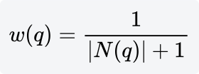

r_nbr 是 `range` 的三分之一。OMPL 把邻域故意设得比采样步长小，好让权重还不至于全都挤在 0 附近。

每来一个新节点，它邻域里每个旧节点的权重做一次

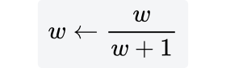

若插入时 w=1/(k+1)，这次更新之后就是 1/(k+2)。稀疏区域的节点权重大，被抽中的概率高。抽节点时按权重抽样，再从抽中的节点出发。

以概率 `goal_bias`（默认 0.05）直接把候选点设成目标。否则在被选中的节点周围、半径 `range` 的球里抽一个点。候选点自己再数一次邻域 N。若 N 非空，以概率

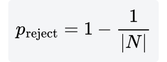

丢掉这个候选点。邻域里只有 1 个点时 p_reject=0；有 5 个点时是 0.8。密的地方既不容易被选中当父节点，局部抽到的点也更容易被拒绝。目标偏置的那一次不做这个拒绝。

线段无碰才把新点接上，父节点是刚才被选中的那个节点。目标偏置抽到的是目标本身，所以这一段可以比 `range` 长；普通样本则落在球里。

[RRT](RRT.md) 在整个空间均匀抽样，再连到最近的节点上。Voronoi 偏置让大的空白区域更容易被射中。EST 不射全局样本：它先按稀疏程度挑一个已有节点，再在那个节点旁边挖一步，并用 p_reject 把挖到密集区的步丢掉。

两种偏置都把树推向还没覆盖的区域。EST 的覆盖更匀，RRT 的长边更多。EST 概率完备，路径长度没有渐近最优保证。

`--planner EST` 找到一条就返回。七轴上它和 RRT 一样是单棵树。它适合拿来看「按密度采样」长出来的树，点到点仍以 RRTConnect 为默认。

## 高代价区域

这一组在 RRT 的扩展上拒绝走进高代价区域。这张桌子和球的场景没有随构型变化的代价，额外的检验几乎不起作用。

### TRRT

TRRT（Transition-based RRT，Jaillet、Cortés、Siméon，2010）在 [RRT](RRT.md) 的 `EXTEND` 上加了两道过滤：最小扩展控制，和基于代价的转移检验。树的形状仍是父指针，找到目标就停，没有 rewire。双向版本是 [BiTRRT](#bitrrt)。

采样、最近邻、steer 与 RRT 相同。`goal_bias` 默认 0.05。steer 之后的顺序是：

1. 线段碰撞则丢掉，温度不变。
2. 最小扩展控制拒绝则丢掉，温度不变。
3. 转移检验拒绝则丢掉，并改温度。
4. 三关都过，才把节点收入树。

记这一步的长度为 d。OMPL 把前沿阈值设成状态空间对角线的 1%：

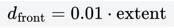

d>d_front 算探索，前沿计数加 1，接受。d 更小算细化。细化节点与前沿节点的个数比已经超过 `frontier_node_ratio`（默认 0.1）时，拒绝这一步。两个计数的初值都是 1，避免除零。

效果是短边大约只占节点的一成。树被鼓励继续往远处长，而不是在已经到过的地方来回补点。

运动代价 c_mot 来自当前的优化目标。OMPL 的 `transitionTest` 是：

- c_mot 不优于 `cost_threshold`（默认 +∞，这关等于开着）：拒绝。
- c_mot<10^(-4)：直接接受，温度不动。
- 否则计算 exp(-c_mot/T)。大于 0.5 就接受。记目前见过的最好、最差状态代价之差为 Δ。若 |Δ|>10^(-4)，

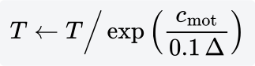

- 不大于 0.5 就拒绝，并且

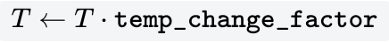

`temp_change_factor` 默认 0.1，`init_temperature` 默认 100。失败时温度乘 0.1，是变冷，接受上坡会更难。论文里的 Metropolis 检验用一次均匀随机数，并且在连续拒绝之后把温度升高，以便爬出局部凹地。OMPL 这段实现用的是 0.5 这个固定门槛，失败时按上面的乘法改 T。

仓库的 `ompl_planning.yaml` 没有写单独的代价。MoveIt 默认的目标函数是路径长度，运动代价就是这一段的关节距离。初温 100 时，exp(-c/100)>0.5 等价于 c<100 ln 2 ≈ 69。一步 steer 的关节距离远小于 69，转移检验通过，成功分支里的降温还要求状态代价有明显的极差。路径长度目标的状态代价是 0，极差不够，温度保持 100。

若请求里根本没有目标函数，TRRT 自己会换成机械功（Mechanical Work）。它的默认状态代价是常数 1，运动代价只剩长度权重 10^(-5) 乘上距离。距离小于 10 时，运动代价低于 10^(-4)，函数在改温度之前就返回接受。

两种默认下，转移检验都不筛选节点。`--planner TRRT` 相对 RRT 仍然多了最小扩展控制，短边会被压到大约一成。

转移检验要起筛选作用，状态代价必须随 q 变化，例如离障碍越近代价越高。上坡（代价变大）只有在 exp(-Δc/T)>0.5 时留下，树会待在代价低的区域里。那是论文里的代价地图用法。当前这张桌子和球的场景没有这种标量场，TRRT 不会比 RRT 更躲开哪一个球，它只是少收短边。

### BiTRRT

BiTRRT 用两棵树跑 TRRT。温度、前沿计数、最好/最差状态代价是两棵树共用的。OMPL 没有给它目标偏置：采样在整个空间均匀抽，终点树的根就是目标。

每一轮对当前树做一次扩展，步骤与 TRRT 相同：最近邻、截断到 `range`、碰撞、最小扩展控制、转移检验。扩展有进展，就让另一棵树朝这个新点一步一步走过去。每一步都要再过这三关。两棵树的距离大于 `connectionRange` 时不尝试连接。OMPL 把这个距离设成「最长有效片段」的 10 倍，所以只有两棵树已经比较近时才会逐段去接。

起点树的运动代价沿父节点指向新点，和 TRRT 一样。终点树的边在路径里是朝目标走的，转移检验用的是从新点走回父节点的运动代价：朝目标爬升很陡的一步会被拒绝，朝目标下降的一步容易通过。两棵树接上之后，从起点树的根走到汇合处，再沿终点树走到目标。

温度共用意味着一边拒绝上坡，另一边的门槛一起变。默认代价下这道门槛几乎不关门，原因和 TRRT 相同：路径长度或常数状态代价使一步的运动代价很小。双向带来的加速与 [RRTConnect](RRTConnect.md) 同一类，连接时多了转移检验和最小扩展控制，所以不会连成一条无视代价的长直线。

`--planner BiTRRT` 找到就停。点到点要快，用 RRTConnect。已经有随构型变化的代价、又希望两端同时长时，用 BiTRRT。

## 外包的缩短

### AnytimePathShortening

AnytimePathShortening 自己不长树。它是包在别的几何规划器外面的一层（Luna、Şucan、Moll、Kavraki，ICRA 2013）。OMPL 的实现和论文有差别：若干线程各自反复出路径，另一条线程做杂交和简化。线程之间不用步调一致。

没有指定内层规划器时，`setup` 按 CPU 核数调用 `SelfConfig::getDefaultPlanner`。关节空间里这种可采样的点目标，默认规划器是 [RRTConnect](RRTConnect.md)。也可以写成逗号分隔的名字，例如 `PRM,EST,RRTConnect`，方括号里可以带那个规划器自己的参数。

每个内层规划器一个线程，各自持有问题的一份拷贝，循环调用 `solve`，直到 `--time` 用完。

一条线程得到可行路径之后，若 `shortcut` 为真（默认真），先做 `partialShortcutPath`：沿路径随机取两个点，两点之间的直线无碰、并且更短，就用这段直线换掉中间的折线。换掉的是几何长度，碰撞检测仍在关节空间的线段上做。

另一条线程维护到目前为止的路径集合。`hybridize` 默认真。杂交在两条路径之间找一对状态：连一条无碰的桥之后，一条路径的前缀接上另一条的后缀，总长度变短，就留下这条拼接。参与杂交的路径最多 `max_hybrid_paths` 条，默认 24。超过就清空集合，避免杂交本身把时间吃完。杂交之后还可以对当前最好的那条做一次完整的 `simplify`（再缩短、再去掉多余顶点）。简化失败就退回简化前的那条。

只有比已有最好代价更短的结果才写回。因此代价曲线只降不升。

[RRT*](RRTstar.md) 在同一棵树里换父节点，时间用来增加样本和 rewire，渐近最优有定理。AnytimePathShortening 的时间用来多跑几次可行规划，再把这些折线剪短、互相拼接。它给本来「找到就停」的规划器加上随时能返回、并且越等越短的行为。它没有 RRT* 那种半径条件下的渐近最优证明。

`--planner AnytimePathShortening` 会把 `--time` 用完。时间很短时，往往只来得及拿到第一条 RRTConnect 的结果，缩短几乎没开始。给数秒，终端里看到的路径通常比单次 RRTConnect 短，树本身不会被画成一张越来越密的 RRT* 图。

点到点要一条能走的路，直接用 RRTConnect，把时间收到 1 秒以内。愿意等、又希望关节折线变短，用这个名字或 RRT*。

## 知情树的变体

### FITstar

FIT*（Flexible Informed Trees，Strub、Zhang、Liang）是知情采样上的自适应批次：当前解的椭球变小，下一批就少加点。OMPL 里的实现还有一棵从终点长回来的启发式树。文献里作为这一类被引用的是 [BIT*](BITstar.md)。本仓库的 `--planner` 列表里没有 `FITstar`。

样本仍是一张隐式随机几何图。默认 `use_k_nearest = true`。近邻个数和 [PRM*](PRMstar.md) 同一条式子，再乘 `radius_factor` η，默认 1.001：

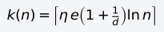

n 是知情集合里的样本数。d = 7、n = 1000 时 k = 22，和 PRM* 落到同一个整数；d = 14、n = 1000 时 k = 21。关掉 k 近邻时，半径是 PRM* 的那一条再乘 η，体积用知情集合的体积。剪枝默认开着。

每一轮只做下面三件里的一件。

反向搜索从终点走。边先做稀疏碰撞检测，默认只查线段上 1 个点。通过之后，这条边可以写进反向树，反向树上的代价是可采纳的 cost-to-go。正向搜索后来发现这条边其实碰了，稀疏检查次数变成上一档的 2 倍再加 1，序列是 1、3、7、15，反向树整棵重来。已经查过的点会记下来，下一次只补新的分辨率。

正向搜索从起点走。弹出的边要能降低目标点在树上的代价，并且加上可采纳的 cost-to-go 之后仍小于当前解，才做全分辨率碰撞检测。无碰就改父节点，子树代价重算。启发式来自这棵反向树。还没有反向树信息时，cost-to-go 退回到无穷，边要等反向搜索把它降下来。

两个队列都没有还能改进当前解的边时，再加一批样本，稀疏检查次数回到 1，反向搜索从头做，正向队列只留下起点的出边。

出现第一条有限代价的路时，`suboptimality_factor` 从无穷改成 1，之后的排序用可采纳下界。默认不做多查询。

写回路径时，从前往后试能不能用一条无碰直线跳过中间状态。跳过的是树上的折线，碰撞检测仍在关节空间的线段上做。

默认打开自适应批次。还没有解时，每批 `batch_size = 199`，这也是上限。下限是 1。

解的代价变了，用当前解的椭圆面积改下一批的大小。实现里用的是二维椭圆的面积，关节空间是 7 维或 14 维时也用这一块面积当标量：

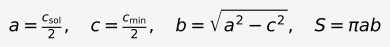

c_sol 是当前解的关节路径长度，c_min 是起点到终点的直线距离。S_0 是第一次得到有限代价时的这块面积。这份实现把 S_0 放在函数里的静态变量上，同一次进程里的下一次规划不会重设。

`iterate` 里写死的衰减是对数这一支：

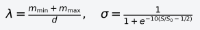

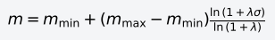

m_min = 1，m_max = 199。d = 7 时 λ = 200/7。第一次解出来，S/S_0 = 1，下一批仍是 199。面积掉到一半，批次大约 160。解已经贴近直线距离、S/S_0 接近 0 时，批次大约 11。d = 14 时同样贴到直线附近，批次大约 8。结果夹在 1 和 199 之间。

椭球还大的时候，一批多加点，图才够密。椭球已经很瘦的时候，少加点，新样本更早进入下一次反向搜索。同一份代码里还有按面积线性缩放、取平方根、按最速降线，以及按迭代次数写成 150、100、80 的几支；当前循环走的是上面的对数。

和 [BIT*](BITstar.md) 一样，时间用完才停，代价只降不升。另外两条停的理由是：当前解已经满足目标函数；当前解等于启发式下界，而且没有更多的起点或终点要加。点到点要快，用 [RRTConnect](RRTConnect.md)。要更短的关节路径，并且希望每批的点数跟着椭球一起变，用 FIT*。每批固定 100、启发式只用到终点的直线距离时，用 BIT*。
