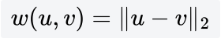
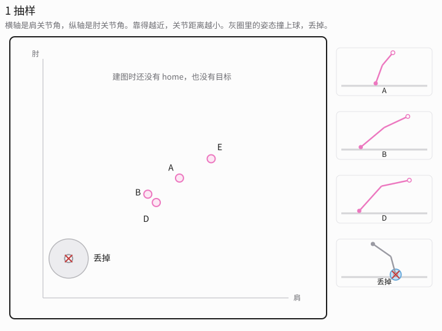
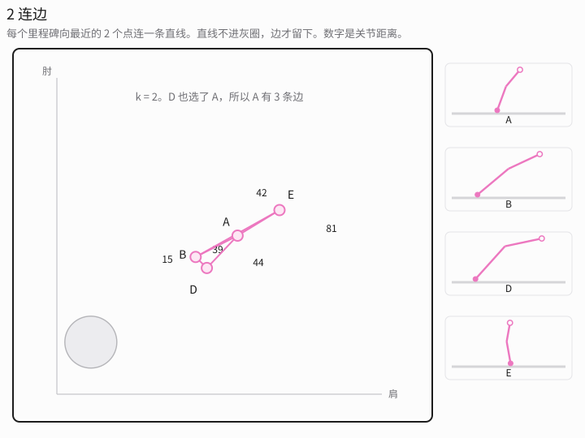
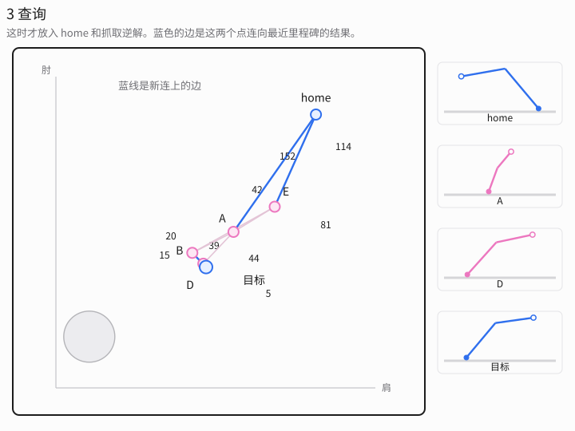
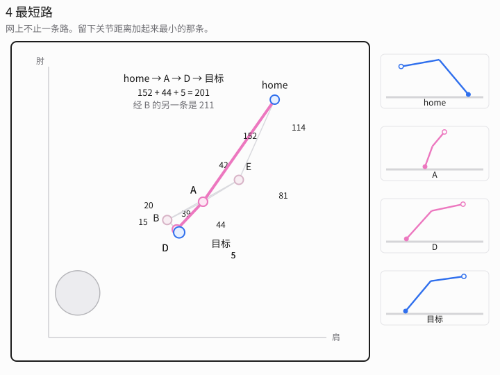
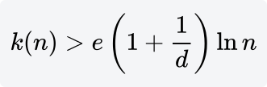

# PRM

[返回目录](README.md)。建图、查询，以及为什么路网上要做 Dijkstra 或 A*，在 [`planning_from_scratch.md`](../docs/planning_from_scratch.md) 第 6、7 节。函数是 `prm_build`、`prm_attach`、`graph_search`。下面这套步骤跑在 Gento Skye 的关节空间里。场景和沿途检查见 [RRT](RRT.md)。

[桌面场景脚本](../docs/scene_gento_skye.py) 先为左右手各求一次从上往下的抓取，留下关节距离 home 更近的那条手臂。规划组是 `right_arm` 或 `left_arm`，构型 q 是 `Joint1` 到 `Joint7` 这 7 个关节角。另一条手臂停在 0。夹爪开度写在起始状态里，不参与搜索；夹爪网格仍随手臂运动，参与和桌板、方块、球的碰撞。目标是 KDL 给出的那组关节角，每个关节容差 ±0.05 rad。`plan_gento_skye.py` 也可以选 `both_arms`，那时 q 是 14 维。

`plan_between` 先试关节空间直线。直线无碰就直接当轨迹，下面的路网不会启动。从 home 到预抓取经常被挡住，才会进入 PRM。

PRM（Probabilistic Roadmap，Kavraki、Švestka、Latombe、Overmars，1996）把建图和查询分开。建图时还不知道这次的 home 和抓取逆解。

## 建图

1. 在关节限位盒子里抽一个构型。这个姿态本身撞上桌板、方块、球或自身，就丢掉再抽。
2. 留下的点叫里程碑。按关节角的欧氏距离，取 k 个最近的里程碑。
3. 连过去的那段关节直线无碰，才写成一条边。

边权是这段的关节长度。

图是无向的。一个里程碑的边数可以大于 k，因为别的点也会选中它。关节距离最近，不等于 TCP 离方块最近。一段很短的关节直线，仍可能让肘扫过球，或让指尖穿过桌板。检查的是整条手臂，含固定开度的夹爪。

下面四张图把 7 个关节收成肩和肘两个角，点才画得出来。点的位置就是这两个角，靠得越近，关节距离越小。灰圈是会撞上球的关节角。图上每个点只连最近的 2 个，机器人上默认是 10。右边的小图是对应的手臂姿态。

## 查询

查询才把起点和目标加进去。起点是当前关节角，home 时七个都是 0。目标落在逆解的 ±0.05 rad 里。各自连向 k 个近邻，然后在这张带权图上做最短路。Dijkstra 和 A* 的这一步见 [Dijkstra](Dijkstra.md)。

[RRT](RRT.md) 的树不用这一步。每个点只有一个父节点，顺着父指针走回去只有一条路。路网有环，从 home 到预抓取可以有很多条，搜索挑的是网上关节长度最短的那条。短的是关节折线。指尖在桌面上走了多少米，要等正运动学算出来。

## 这台手臂上的 k

OMPL 的 `PRM` 使用固定的 k。默认 `max_nearest_neighbors = 10`。这 10 个近邻里包含它自己，连边时跳过自己，所以每个新里程碑实际尝试 9 条边。

近邻个数有一个充分条件。维数 d 时，

e(1+1/d)ln n" style="max-width:100%; height:auto;">

单臂 d = 7、n = 1000 时，右边大约是 21.5。固定的 k = 10 小于它。大约从第 26 个里程碑起，这个下界就已经超过 10。充分条件不是必要条件。手贴着方块、球夹在中间时，路网仍可能断成两块，查询失败，那些线段检测却已经做过了。把 k 提高到这个下界，就是 [PRMstar](PRMstar.md)。

## 路网留不留

同一张桌子、同一批障碍还在时，下一次查询只把新的起点和新的逆解接到这张网上，再搜一次。树状规划器在目标一变时整棵作废。

MoveIt 一次 `plan()` 结束就把图丢掉。桌面脚本的接近、靠近、抬起是三次请求，不会共用一张网。多查询的好处要在同一次规划里、多个目标接在已经建好的图上时才看得到。

方块被挪走，或球的位置变了，旧边可能穿进新障碍。那时要重建，或者改用 LazyPRM：边先假定能走，最短路搜出来之后只检查这条路径上的边，撞了就删掉再搜。[SBL](KPIECE_BKPIECE_LBKPIECE_SBL_EST_TRRT_BiTRRT_AnytimePathShortening_FITstar.md#sbl) 和 [LBKPIECE](KPIECE_BKPIECE_LBKPIECE_SBL_EST_TRRT_BiTRRT_AnytimePathShortening_FITstar.md#lbkpiece) 把同一种推迟用在树上。

`--planner PRM` 的 `--time` 是建图预算，建完再查询。一次抓取只要一条能走的路，先用 [RRTConnect](RRTConnect.md)。
