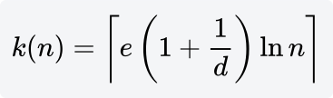
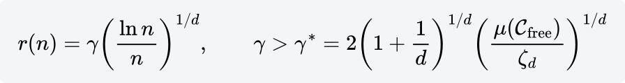

# PRMstar

[返回目录](README.md)。固定 k 的建图和查询见 [PRM](PRM.md)。半径形式的同一条定理写在 [RRTstar](RRTstar.md)。

PRM* 是 Karaman 和 Frazzoli 2011 年论文里的渐近最优路网。里程碑仍是 Gento Skye 选中那条手臂的 7 个关节角，边仍是无碰的关节直线，查询仍是把 home 和逆解容差接到网上再做最短路。另一条手臂和夹爪开度不进搜索，夹爪网格仍参与和桌板、方块、球的碰撞。`both_arms` 是 14 维。

和 `PRM` 的差别只在近邻个数。OMPL 的 `PRMstar` 不使用半径，它使用随里程碑个数增长的 k。`KStarStrategy` 里

n 是当前里程碑个数，含正在加入的这一个，d 是关节空间维数，ln 是自然对数。常数来自 e + e/d。

对每个新点，OMPL 取 k(n) 个关节距离最近的里程碑。其中距离为 0 的那个是它自己，连边时跳过，所以真正做碰撞检查的是另外 k(n) − 1 条线段。无碰的线段才写入无向图。边权仍是关节长度。

单臂 d = 7：

| n | e · (8/7) · ln n | k(n) | 实际检查的边 |
|---|---|---|---|
| 10 | 7.15 | 8 | 7 |
| 100 | 14.31 | 15 | 14 |
| 1000 | 21.46 | 22 | 21 |
| 10000 | 28.61 | 29 | 28 |

`PRM` 的 k 一直是 10。大约从第 26 个里程碑起，上表这个下界就超过 10，之后每加一个点，PRM* 要比 PRM 多查几条关节直线。

论文里的充分条件是严格大于 e(1+1/d) ln n。`ceil` 再丢掉自己之后，尝试次数落在这个下界附近。维数升高时 k 变小，因为 1 + 1/d 趋近 1。双臂 d = 14、n = 1000 时，k = ceil(e · (15/14) · ln 1000) = ceil(20.12) = 21，实际检查 20 条边。

同一篇论文还有半径形式。第 n 个点连上球

里的所有点。OMPL 的 PRM* 走的是 k 近邻这一支，不允许再调用 `setMaxNearestNeighbors`。本机 OMPL 1.7 的 RRT* 默认也是 k 近邻，并且多乘了 `rewire_factor = 1.1`，所以 d = 7、n = 1000 时 RRT* 的 k 是 24，PRM* 的 k 是 22。半径那一支的 γ* 和单臂体积见 [RRTstar](RRTstar.md)。

两边的充分条件都给出渐近最优：采样趋于无穷，并且近邻守住下界时，网上的最短路收敛到关节空间里最优路径的概率是 1。一次数秒的运行离这个极限很远。样本不够时，图在手贴方块、球夹在中间的窄缝里仍会断开。

和 `PRM` 比，路网更密，碰撞检测更多，同一次 `--time` 里能放下的里程碑更少，查到的关节路径通常更短。`--time` 仍是建图预算，建完再查询。

14 维里 k 本身略减。变稀的是样本：同样 1000 个点撒进双臂的限位盒子，间距比 7 维大得多，窄缝更容易把图断开。一次抓取只要一条能走的路，先用 [RRTConnect](RRTConnect.md)。
