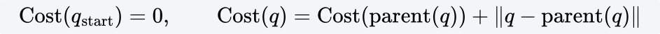
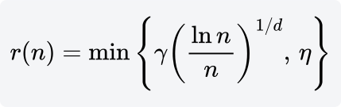
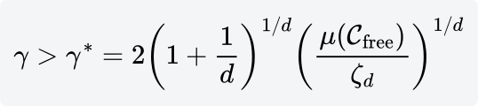

# RRTstar

[返回目录](README.md)。半径、选父节点和 rewire 的推导在 [`planning_from_scratch.md`](../docs/planning_from_scratch.md) 第 8 节，函数是 `rrt_star`。下面把同一套步骤放在 Gento Skye 的关节空间里。场景和沿途检查见 [RRT](RRT.md)，两棵树的接法见 [RRTConnect](RRTConnect.md)。

桌面脚本选中一只手臂后，树长在这 7 个关节的限位盒子里。起点是当前关节角，home 时七个都是 0。终点是 KDL 那组解的 ±0.05 rad。另一条手臂和夹爪开度不进搜索，夹爪网格仍参与碰撞。`both_arms` 是 14 维，桌面抓取不用它。

RRT*（Karaman、Frazzoli，2011）仍是从起点长出的一棵树。采样和 steer 与 [RRT](RRT.md) 相同。多出来的是父节点选择和 rewire：新构型不挂到关节距离最近的节点上，而挂到「从起点走到它」总代价最小的近邻；写进树之后，再看附近已有的构型能不能改道经过它而变短。

代价是关节空间路径长度。

它短的是关节折线。TCP 在桌面上走了多少米、回放用了多少秒，要等正运动学和时间参数化之后才有。

[RRT](RRT.md) 和 [RRTConnect](RRTConnect.md) 接到一条能走的路就停。RRT* 的停止条件是时间。第一条路出现之后，剩下的时间用来换父节点和 rewire，关节路径长度只减不增。它换来的是更短的关节路径，不是更快的第一棵树。

`plan_between` 先试关节空间直线。直线无碰时 RRT* 不会启动。从 home 到预抓取被桌板或球挡住时，才会把 `--time` 交给这棵树。

## 一个新构型怎么进树

1. 在关节限位里抽 `q_rand`，找到关节距离最近的节点，沿这个方向走出不超过 η 的一段。这段无碰，才得到 `q_new`。到这里和 RRT 一样。碰桌板、球或自身，这一步丢弃。
2. 收集 `q_new` 的近邻，线段无碰的才留下。本机 OMPL 1.7 默认按近邻个数收集，见下面的 k(n)。关掉 `use_k_nearest` 之后，近邻是关节空间里半径 r(n) 的球。最近节点如果落在球外，也并进来：一步的长度可以正好是 η，而 r(n) < η 时它会在球外面。
3. 父节点是这些候选里 `Cost(q) + ‖q_new − q‖` 最小的那个。关节距离最近的点可以落选。
4. `q_new` 写入树。对每个近邻，若 `Cost(q_new) + ‖q − q_new‖` 小于它现在的 `Cost`，并且线段无碰，就把父节点改成 `q_new`。改完，以它为根的子树要重算 `Cost`。漏掉这一步，后面的比较还用旧代价，树还可能连成环。

一次加入可以用这组关节长度看比较顺序。数字是示意，不是某次规划的日志。

- 从 home 走到 A 的代价是 1.20，走到 B 的代价是 1.60。
- `q_new` 离 A 0.40，离 B 0.20。
- 经 A：1.20 + 0.40 = 1.60。经 B：1.60 + 0.20 = 1.80。父节点是 A。B 更近，总代价更高。
- C 现在的代价是 2.10，离 `q_new` 0.30。改挂之后是 1.60 + 0.30 = 1.90，更短，于是 rewire。C 下面的子树代价要重算。

终点不放进随机采样里，单独记一条最好的接入：近邻规则之内、能无碰连到目标容差的节点中，取 `Cost(q_i) + ‖q_goal − q_i‖` 的最小。某次 rewire 把接入点的代价降低了，这条接入也要跟着刷新。OMPL 里这条接入的目标是容差盒中的构型，七个关节都落在逆解 ±0.05 rad 里。

默认 `goal_bias = 0.05`：大约每二十次抽样有一次直接朝目标区域拉。头文件里的 `delay_collision_checking` 默认打开，选父节点时按代价从低到高检查，找到第一条无碰的父边就停。rewire 仍要检查准备改挂的那条边。

## 半径

第 n 个节点加入时，邻域半径是

d 是关节空间维数。单臂 d = 7，双臂 d = 14。ζ_d 是 d 维单位球的体积，ζ_7 ≈ 4.72。定理要求

这里的 μ 用关节限位盒子的体积，障碍不从体积里扣。桌子、方块和球只在碰撞检查时把构型丢掉。单臂七个关节的行程（弧度）是

6.21，4.19，6.21，3.58，6.21，2.09，3.14

相乘得 μ ≈ 2.37×10^4。代进定理：γ* ≈ 6.88。系数再放大一成是 OMPL 的默认 `rewire_factor = 1.1`，得到 γ ≈ 7.57。

`(ln n / n)^{1/7}` 本身小于 1。乘上 7.57 之后，和一步 η 谁小要看节点个数。η 用 [RRT](RRT.md) 里的估算 2.53（限位盒子对角线 12.67 的 0.2 倍，yaml 没有写 `range`，也没有从 `move_group` 读出）：

| n | (ln n / n)^{1/7} | 7.57 × 该项 | 与 2.53 取最小 |
|---|---|---|---|
| 3 | 0.866 | 6.56 | 2.53 |
| 1000 | 0.491 | 3.72 | 2.53 |
| 10000 | 0.368 | 2.79 | 2.53 |
| 21200 | 0.335 | 2.53 | 2.53 |
| 100000 | 0.274 | 2.07 | 2.07 |

节点还不到大约 2.1 万时，公式半径比一步更大，截断之后邻域就是一步之内。几秒的规划长不出这么多节点，所以这条半径在单臂上长时间停在步长上。

本机 OMPL 1.7 的默认是近邻个数，不是这颗球。头文件里 `use_k_nearest = true`，仓库的 yaml 没有改它。个数是

`k(n) = ceil(1.1 · e · (1 + 1/d) · ln n)`

d = 7、n = 1000 时 k = 24。d = 14、n = 1000 时 k = 23。每个新构型只和这么多个关节距离最近的节点比较。要改走半径，得在参数里关掉 `use_k_nearest`。`setRange` 仍然是步长 η，和近邻半径是两件事。

双臂的限位盒子体积约 5.60×10^8，γ* ≈ 8.79，对角线约 17.91，按同样的 0.2 倍估算 η ≈ 3.58。桌面抓取不规划这 14 维。

半径写成 `(ln n / n)^{1/d}`，是为了让球里的点数随 ln n 增长。定理把系数放到 γ* 以上，体积上多出来的是 2^d 这一档。证明见 Karaman 和 Frazzoli 2011。

## 时间用在变短

`--planner RRTstar` 配 `--time 8` 的含义是：这 8 秒用来磨短关节路径，找到不会立刻返回。点到点要快，用 [RRTConnect](RRTConnect.md)。

渐近最优指的是：采样次数趋于无穷，并且近邻满足上面的下界时，关节路径代价收敛到最优代价的概率是 1。7 维限位盒子里，一次数秒的运行离这个极限很远。它仍然是随机的。同一次 `--time` 里，两次运行的折线不一样。
