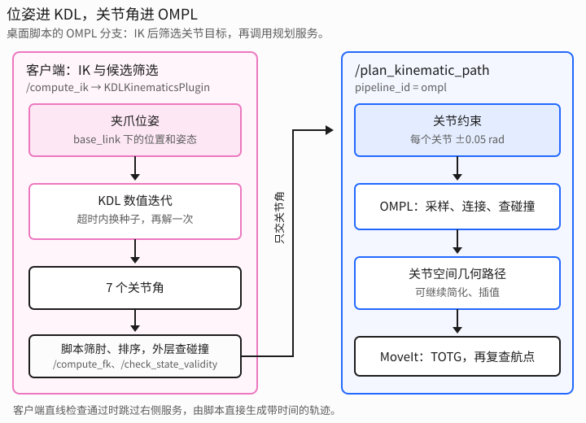
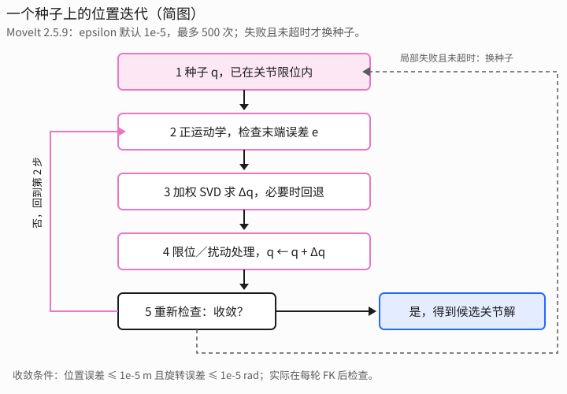
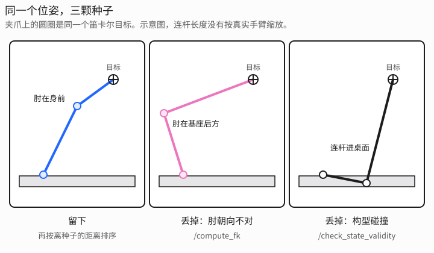
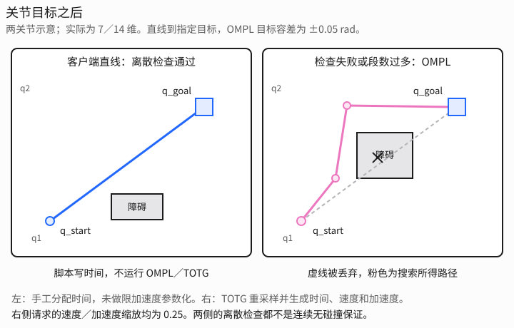

# 一次规划里的两段循环

[返回目录](README.md)。在本文的桌面脚本中，笛卡尔位姿先交给 KDL 求逆解；脚本筛选关节解，再把关节目标交给 MoveIt 的 OMPL 规划管线。OMPL 在关节空间里找路，MoveIt 提供碰撞检查和时间参数化。**这个“先 IK、后关节目标规划”的分工适用于本脚本，不能推广成所有 MoveIt 位姿目标请求都只在规划前调用一次 IK。**

[桌面场景脚本](../docs/scene_gento_skye.py) 把这两段拆成 `/compute_ik` 和 `/plan_kinematic_path` 两类服务调用，中间还有 FK 和状态有效性检查；直线插值成功时不调用规划服务。[关节目标规划脚本](../docs/plan_gento_skye.py) 的目标已经是关节角，所以不走 IK。

以下参数以桌面脚本为准；KDL 实现按本机 ROS 2 Humble、MoveIt 2.5.9 核对，源码依据见文末。

## 调用顺序

桌面脚本里，一个抓取阶段是：

1. `solve_ik` 向 `/compute_ik` 要关节解。[逆运动学配置](../gento_skye_moveit_config/config/kinematics.yaml) 指定的求解器是 `kdl_kinematics_plugin/KDLKinematicsPlugin`。
2. `solve_ik` 用正运动学筛选肘的位置，并按与种子的关节距离排序。外层流程再用 `/check_state_validity` 检查候选构型，包括自碰撞和与场景物体的碰撞。
3. `plan_between` 优先尝试关节空间直线；检查失败或插值段数超过上限时，调用 `plan_group`，向 `/plan_kinematic_path` 发关节目标。`pipeline_id` 是 `ompl`，`planner_id` 是 `--planner` 选的名字，例如 `RRTConnect`。
4. 走 OMPL 管线时，[OMPL 配置](../gento_skye_moveit_config/config/ompl_planning.yaml) 里的 `AddTimeOptimalParameterization` 做时间参数化，请求里的速度、加速度缩放都是 0.25。直线分支的时间则由脚本自己分配，不经过这个适配器。

第 1 步结束时还没有 OMPL。初始求解器 [kdl_arm_ik.py](../kdl_arm_ik.py) 把选臂放在这一步里：左右臂各解 7 个关节，留下更适用的那一只，详见后文「左右臂都在 KDL 里解完，OMPL 还没开始」。场景脚本的 `main()` 仍走自己的 `/compute_ik`，不会读取它的打印。

RViz 的普通 Plan 流程也要区分交互和规划：在 Humble 中，拖动末端标记时，交互组件先通过 IK 更新目标 `RobotState`；点击 Plan 后，界面调用 `setJointValueTarget()`，提交的是关节目标。不是必然在同一次 `plan()` 里先调用 `/compute_ik` 再规划；Cartesian Path 模式是另一条流程。

如果应用直接提交位置／姿态目标约束，MoveIt 的 OMPL 接口可使用 `IKConstraintSampler`，在规划期间调用 IK，采样多个目标关节状态。OMPL 核心算法不依赖 KDL，但不能因此说整个 MoveIt–OMPL 规划过程不会调用 IK。



在本脚本的规划请求里，位姿已经不在目标中。`goal_constraints` 的元素是 `Constraints` 消息，其中的 `joint_constraints` 才是一组 `JointConstraint`：关节名、关节角、上下容差。搜索状态也是关节角。这里不再需要 KDL 生成目标；KDL 的数值迭代本身不检查整条路，也不读取桌面和球的碰撞几何。

## KDL 里面的循环

左右臂的配置是：

```yaml
kinematics_solver: kdl_kinematics_plugin/KDLKinematicsPlugin
kinematics_solver_search_resolution: 0.005
kinematics_solver_timeout: 0.05
```

7 轴对完整的 6 维末端位姿通常有冗余：在雅可比满秩时，解在局部往往构成一维连续集合，而不只是“肘上、肘下”两个离散解。**7 轴不等于一定没有解析解**；能否推导解析解取决于机构和冗余参数化。这里选用的 KDL 插件采用数值迭代。

正运动学是 `ChainFkSolverPos_recursive`：连杆变换连乘，得到当前末端位姿。速度层是 `ChainIkSolverVelMimicSVD`：在当前关节角处，用加权 SVD 伪逆求解局部线性问题 $J(q)\,\Delta q \approx e$。这里完整位姿任务的 $J$ 是 $6\times7$，$e$ 是位置和旋转误差组成的 6 维向量；虽然接口把输出称为 `qdot`，位置迭代里把它用作关节增量，并不代表最终轨迹的执行速度。

SVD 默认阈值参数是 0.001，但该实现调用 Eigen 的 `setThreshold()`，用的是相对于最大奇异值的判定，不是简单丢弃所有绝对值小于 0.001 的奇异值。截断小奇异值方向可抑制伪逆在奇异位形附近的放大。若链中含 mimic 关节，其贡献会合并到驱动关节，不作为独立未知数；本项目手臂组的 7 个自由度不包含夹爪开合。

位置层是插件自己的 `KDLKinematicsPlugin::CartToJnt()`，**不是 `ChainIkSolverPos_NR_JL`**。从种子 $q$ 出发，其主要逻辑是：

1. 正运动学得到末端位姿，计算位置误差范数和旋转误差范数；两者均不大于 `epsilon` 时成功。
2. 通过速度层求关节增量；如果误差没有下降，则回退并缩小上一步的步长。
3. 用 `clipToJointLimits()` 裁剪增量，并降低触及限位的关节在后续求解中的权重；增量过小时，还可能施加小幅随机扰动。
4. 更新 $q \leftarrow q+\Delta q$，继续迭代；收敛、无法继续推进或达到迭代上限时退出。

该版本默认 `epsilon = 1e-5`、`max_solver_iterations = 500`，本项目配置没有覆盖它们。位置误差以米计，旋转误差以弧度计；这与规划目标的关节容差不是一回事。下图只展示主循环，回退和扰动细节以上述逻辑为准。



一次局部求解只给出一个候选解，不保证它是离种子最近的解。插件先试请求提供的种子；失败或候选被有效性回调拒绝后，再随机换种子，直到成功或超时。该版本的随机重启循环没有按 `kinematics_solver_search_resolution: 0.005` 枚举冗余关节，不能把这个配置值解释为实际使用的扫描步长。它也不以肘朝向或避障作为零空间优化目标。

桌面脚本把每次 `/compute_ik` 请求的超时改成 80 ms；`lock_orientation=True` 时是 250 ms。该开关控制脚本是否只尝试指定姿态，而不是把 KDL 从“仅位置 IK”切换成“完整位姿 IK”：这里每次请求本来就包含位置和姿态。插件在局部求解尝试之间检查超时，因此这个值不是严格的服务墙钟时限；脚本还会为不同位置／姿态发出多次请求。

脚本把 `avoid_collisions` 设为 `False`，将碰撞筛选移到外层。若设为 `True`，MoveIt 可通过解有效性回调拒绝碰撞候选，KDL 再继续搜索，而不是每一步数值迭代都检查碰撞。短超时内若只找到碰撞解，启用检查就可能找不到可接受解；这并非必然。实际顺序是：`solve_ik` 用 `elbow_in_front` 和 `/compute_fk` 筛选肘的位置，再按关节距离排序、截取候选；外层单臂或双臂配对流程才调用 `goal_is_valid`，通过 `/check_state_validity` 检查组合后的构型。IK 返回成功本身不代表无碰撞。



## 左右臂都在 KDL 里解完，OMPL 还没开始

选哪只手属于这一节的逆解，不属于后面的 OMPL。仓库根目录的 [kdl_arm_ik.py](../kdl_arm_ik.py) 不调用 `/plan_kinematic_path`，不跑 `RRTConnect`，也不读桌子和球。它不替换上面 MoveIt 插件里的随机重启。场景脚本的 `main()` 仍自己调用 `/compute_ik`，还不会读取这里打印的关节角。

不写 `--arm` 时，同一个 `base_link` 位姿送进两条链，腰的三个关节锁住，每只手只解自己的 7 个转动关节：

- 右臂：`waist_Link_3` → `TCP_Link_R`
- 左臂：`waist_Link_3` → `TCP_Link_L`

每条链先用 `ChainIkSolverPos_LMA`，6 个任务权重都是 1，位置和朝向一样重要。这组角留在 URDF 限位里并且手已经对上，就用它。角越出限位时，同一组种子再用 `ChainIkSolverPos_NR_JL` 和 `ChainIkSolverVel_wdls` 解一次，每一步都把关节夹在限位里。阻尼为什么要会松会紧、限位为什么要在拧之前就生效，见 [ik_solving.md](../docs/ik_solving.md)。种子是该侧参考角（`--seed`，不写就是 7 个 0；两侧当前角不同时用 `--seed-right` 和 `--seed-left`）、屈肘、几组 `Joint3` 滚转，以及两组把手伸到身前的起始角。回零时两只手在身体两侧，单靠全 0 不容易够到桌面。conda 里的 Python 没有 PyKDL，用 `/usr/bin/python3`。

两侧都求出候选之后，按这个顺序留一只手：

1. 正运动学对得上的解才进入比较。位置残差要小于 0.1 mm，姿态残差要小于 0.0001 rad。对不上的一侧只留下残差。
2. 肘在身前的解优先于肘在身后的解。规则与 `elbow_in_front()` 相同。
3. 剩下的解里，取离该侧种子关节距离更小的一只。
4. 两侧距离差不超过 0.25 rad，而且目标的 y 离开中线超过 0.05 m 时，留目标那一侧：y < 0 用右臂，y > 0 用左臂。

```bash
/usr/bin/python3 kdl_arm_ik.py \
  --xyz 0.70 -0.18 0.52 \
  --quat 0.31100 0.65408 0.40126 0.56075
```

这条命令腰锁在 0，两侧种子都是全 0。右臂对上了，左臂还差 `3.421e-01` m 和 `5.500e-01` rad，所以留下右臂，`reason=only_converged`。右臂关节角是 `Joint1_R=-0.390595`，`Joint2_R=-0.994181`，`Joint3_R=-0.286879`，`Joint4_R=-1.266021`，`Joint5_R=-0.398655`，`Joint6_R=0.735633`，`Joint7_R=-0.274304`。正运动学回到 `(0.700000, -0.180000, 0.520000)`。数值和退出码见 [grasp_planner_recommendation.md](../docs/grasp_planner_recommendation.md)。

到这里为止，结果只是选中手臂的 7 个关节角。「OMPL 里面的循环」才把它们写成 `JointConstraint`，交给关节直线或 OMPL。`converged=0` 时没有关节目标，规划不会开始。

## KDL 自带求解器，以及库外的选择

按这只手臂的四条取舍排过的对照表见 [ik_solver_comparison.md](../docs/ik_solver_comparison.md)。本机 `python3-pykdl` 与 `liborocos-kdl` 都是 1.5.1。`kdl_arm_ik.py` 的内层已经调用 `ChainIkSolverPos_LMA`，6 个权重都是 1；角越出限位时再调用 `ChainIkSolverPos_NR_JL` 和 `ChainIkSolverVel_wdls`。`kinematics.yaml` 里的 `KDLKinematicsPlugin` 走的仍是前面的 `CartToJnt()`，不调用这些类。场景脚本的 `main()` 也还没有换成它们。旧版手写阻尼步和现在这组结果的对照见 [ik_solving.md](../docs/ik_solving.md)。

| 求解器 | 这一步在做什么 | 关节限位 | 对这只 7 轴手臂 |
|---|---|---|---|
| `ChainIkSolverPos_NR` + `ChainIkSolverVel_pinv` | 牛顿迭代，速度层是无阻尼伪逆。默认最多 100 次，`eps` 默认 `1e-6` | 无 | 奇异附近关节增量会被放大 |
| `ChainIkSolverVel_pinv_givens` | 另一份无阻尼伪逆，只接收链 | 交给外面的 `NR` 或 `NR_JL` | 与 `pinv` 同一类 |
| `ChainIkSolverPos_NR_JL` + `ChainIkSolverVel_wdls` | 牛顿迭代外包关节限位。速度层是加权阻尼最小二乘：`J# = Mq · Vb · pinv_dls(Db) · Ubᵀ · Mx`。关节权重、任务权重和阻尼 `lambda` 分开设置 | 有。构造函数接收 `q_min`、`q_max` | 库里同时带阻尼和限位的组合。阻尼是固定的 `lambda`，不会随误差自动加大。没有朝种子的零空间，也没有肘和选臂 |
| `ChainIkSolverPos_NR_JL` + `ChainIkSolverVel_pinv_nso` | 零空间最小化 `0.5 · Σ weight · (q_desired − q)²`，也就是 Liégeois 1977 的冗余分解。默认零空间增益 `alpha = 0.25` | 有，限位在 `NR_JL` 里 | 旧的手写循环在位姿靠近之后拉向种子，和这项是同一类二次任务。现在的脚本不再拉。这条伪逆没有阻尼 |
| `ChainIkSolverPos_LMA` | Levenberg-Marquardt。阻尼随误差自动调整，任务权重把位移和旋转分开。默认最多 500 次 | 构造函数只接收链、任务权重、`eps` 和迭代上限 | 头文件把自适应阻尼写成更稳的阻尼步。默认权重会压低旋转，见下一段 |

`ChainIkSolverPos_LMA` 的默认任务权重是 `L = diag(1, 1, 1, 0.01, 0.01, 0.01)`，前三个是位移，后三个是旋转。代价是 `E = Δxᵀ L Lᵀ Δx`，所以旋转项的系数是 `0.01² = 10⁻⁴`，位移项是 1。桌面抓取要锁住姿态时，这 6 个数要设成同一数量级，例如全为 1。它的 `eps` 作用在加权后的标量 `E` 上，默认 `1e-5`。这和脚本里分开判断的 0.1 mm、0.0001 rad 不是同一个停止条件。LMA 给出的关节角还要在外层对照 URDF 限位，越限的解丢掉。

所以库内这两步已经接进 `kdl_arm_ik.py`，没有接进 `main()`：

- 位姿收敛用 `ChainIkSolverPos_LMA`，6 维任务权重都是 1。
- 角越出限位，或手还没对上，再用 `ChainIkSolverPos_NR_JL` 配 `ChainIkSolverVel_wdls`。
- `NR_JL` 配 `pinv_nso` 能把关节拉向一组期望角，但这条伪逆没有阻尼，脚本没有用它。

左右臂比较、肘在身前、屈肘和 `Joint3` 那组种子，这些类都不做。一次 `CartToJnt()` 仍然只给一个局部解。脚本外层的四条筛选还要留着。

本机已安装的包里没有 TRAC-IK、IKFast、bio_ik、pick_ik 和 Pinocchio。它们和 KDL 的局部迭代不是同一件事。本仓库的 `kinematics.yaml` 也只有 `kdl_kinematics_plugin/KDLKinematicsPlugin`。

| 库 | 它额外做的事 | 接到这次抓取时仍留在库外的事 |
|---|---|---|
| TRAC-IK | 同一时限里并行跑 KDL 和 NLopt 的序列二次规划，关节限位写在求解里。MoveIt 插件是 `trac_ik_kinematics_plugin/TRAC_IKKinematicsPlugin`，用来替换 `kinematics.yaml` 里的 KDL 插件 | 肘在身前、左右臂取舍。碰撞仍是 MoveIt 的有效性回调，或者后面的关节直线和 OMPL |
| IKFast | 按这一版 URDF 生成解析逆解。7 轴要指定一个自由关节，再沿这个关节离散取样 | 自由关节的取样决定肘的位置。生成物只属于这一版模型。碰撞和选臂仍在外面 |
| bio_ik、pick_ik | 把位姿误差、关节居中和肘的位置写成同一组目标。肘可以进代价，而不只是解完再筛。插件分别是 `bio_ik/BioIKKinematicsPlugin`、`pick_ik/PickIkPlugin` | 结果依赖权重和重启。当前 `main()` 没有接这两个插件 |
| Pinocchio 与 pink | 同一次二次规划里写关节限位、速度限位和碰撞不等式 | 碰撞就从「KDL 之后交给 OMPL」变成求解器自己的约束。依赖也不是现在这条 PyKDL 脚本 |

这次抓取仍用 `kdl_arm_ik.py` 的外层：两臂都解，肘在身前，短行程，目标在身体一侧时留那一侧。内层已经是 LMA，权重为 6 个 1；越限时用 `NR_JL` 加 `wdls`。TRAC-IK 是在相同时限里再用二次规划搜一次，IKFast 是按这一版模型给出解析解，两者都不做肘和选臂。bio_ik 和 pick_ik 才把肘写进代价。这些库都还没有装进当前环境，也没有接到 `main()`。本文没有用它们求解过 Gento Skye。

## OMPL 里面的循环

本脚本交给 OMPL 管线的是筛选后的关节目标。`plan_group` 把每个目标关节写成一条 `JointConstraint`，容差 ±0.05 rad。到达目标容差范围不等于精确到达原 IK 位姿，也不约束末端沿途保持姿态或走笛卡尔直线。规划组 `right_arm` / `left_arm` 是 7 维，`both_arms` 是 14 维。夹爪开度写在起始状态里，不参与搜索；夹爪碰撞几何仍随手臂移动，按场景的碰撞配置参与检查。

注意：[关节目标规划脚本](../docs/plan_gento_skye.py) 使用的是 ±0.08 rad 容差、4 次规划尝试，不是桌面脚本的 ±0.05 rad、8 次。

OMPL 的循环由 `--planner` 决定，共同的部分是：

1. 起点来自请求的 `start_state`，与当前场景状态合并；配置中的起点修正适配器还可能修正轻微越界或碰撞。终点是满足目标关节容差的有效构型。
2. 在关节空间里采样和连接状态，通过 MoveIt 提供的状态有效性检查做离散碰撞检测；具体策略由算法决定，并非所有算法都长树。
3. 单个 `RRTConnect` 实例通常找到可行解就结束搜索；`RRTstar` 等优化型规划器通常会在剩余预算内继续改善路径，也可能因其他终止条件提前结束。管线之后还可简化和插值路径，因此“找到第一条路”不等于服务立刻返回。各算法的循环见同目录的单篇，同一类树的改法集中在 [KPIECE、BKPIECE、LBKPIECE、SBL、EST、TRRT、BiTRRT、AnytimePathShortening、FITstar](KPIECE_BKPIECE_LBKPIECE_SBL_EST_TRRT_BiTRRT_AnytimePathShortening_FITstar.md)。
4. 场景脚本的 `num_planning_attempts = 8` 表示请求多次求解。Humble 的 MoveIt OMPL 接口可通过 `ParallelPlan` 并行或分批运行多个规划器实例，并进行路径混合；它不是“失败后才重开一棵树”的简单重试，也不是每次都获得完整的 `allowed_planning_time`。这些尝试共享本次请求的时间预算。

`plan_between` 先调用客户端的 `interpolated_motion`，并不是 OMPL 内部先试一条直线。令 `peak` 为各关节起终点差的最大绝对值，段数为 `max(4, ceil(max(peak, 1e-4) / 0.08))`：每个关节相邻采样点的变化不超过约 0.08 rad，不是整组关节的欧氏距离为 0.08 rad。段数超过 50 时直接跳过，否则对包含起终点的所有采样点调用 `/check_state_validity`。全部通过就直接生成轨迹；检查失败或超过段数上限，才转到 `plan_group`。

这条捷径旨在减少短程抓取阶段不必要的绕行，但“末端只差几厘米”不保证关节距离很短；OMPL 也不会有意接受检测到的碰撞。两条分支的离散检查都不能证明采样点之间连续无碰撞。



## 时间打在路径之后

OMPL 的几何规划结果本身没有执行时间。MoveIt 的 `AddTimeOptimalParameterization` 使用 TOTG，依据 [关节速度和加速度上限](../gento_skye_moveit_config/config/joint_limits.yaml) 及请求中的两个 0.25 缩放系数，生成 `time_from_start`、速度和加速度。因此 `/plan_kinematic_path` 的成功响应已经经过时间参数化，而不是还要由客户端给 OMPL 结果补时间。

TOTG 不只是给原折线的每个点贴时间戳：它会拟合并重采样路径，允许在路径容差内偏离原路径。TOTG 自身不做碰撞检查；Humble 的规划管线默认会在适配器执行后复查输出航点，但这仍不是连续碰撞保证。

直线分支不调用 TOTG。脚本用 $T=\max(\mathrm{peak}/(0.25\pi),\,0.6)$ 秒作为总时长，均匀分配给插值点，只填写位置和时间；它没有读取逐关节加速度上限，也没有生成速度／加速度字段。不能把这条分支称为满足相同限速、限加速度约束的 TOTG 轨迹。

IK 搜索时间、路径搜索时间和轨迹执行时长是三个不同概念：

| 参数 | 谁在用 | 桌面脚本里的值 |
|---|---|---|
| `/compute_ik` 的 `timeout` | 单次请求中 KDL 的局部求解与重启 | 80 ms，锁姿态时 250 ms；不是整个 `solve_ik` 的总预算 |
| `kinematics_solver_timeout` | 未显式指定超时时使用的默认逆解预算 | 0.05 s；脚本在请求中显式指定了超时 |
| `allowed_planning_time` | OMPL 接口搜索及后续路径简化的预算 | `--time`，默认 8 s；不包含前面的 IK 和客户端直线检查 |
| `time_from_start` | 轨迹点相对于轨迹起点的执行时间 | 由 TOTG 或直线分支的手工时间分配得到，不等于规划耗时 |

在这条脚本流程中，IK 或候选筛选失败时，相应候选不会进入后续路径规划。规划服务失败则不一定是“树在障碍里没接上”：起点／目标无效、请求或规划器配置错误、搜索超时、时间参数化失败、最终路径复查失败等都可能导致失败，应结合 `error_code` 和服务端日志定位。

## 实现依据

- [MoveIt 2.5.9：KDL 插件](https://github.com/moveit/moveit2/blob/2.5.9/moveit_kinematics/kdl_kinematics_plugin/src/kdl_kinematics_plugin.cpp)：`CartToJnt()`、默认迭代参数、随机重启和限位处理。
- [MoveIt 2.5.9：速度层 SVD](https://github.com/moveit/moveit2/blob/2.5.9/moveit_kinematics/kdl_kinematics_plugin/src/chainiksolver_vel_mimic_svd.cpp)：加权雅可比、mimic 映射和 Eigen 阈值接口。
- [MoveIt Humble：RViz 规划入口](https://github.com/moveit/moveit2/blob/humble/moveit_ros/visualization/motion_planning_rviz_plugin/src/motion_planning_frame_planning.cpp)与[目标约束采样](https://github.com/moveit/moveit2/blob/humble/moveit_planners/ompl/ompl_interface/src/detail/constrained_goal_sampler.cpp)：关节目标与位姿目标的不同路径。
- [MoveIt Humble：OMPL 规划上下文](https://github.com/moveit/moveit2/blob/humble/moveit_planners/ompl/ompl_interface/src/model_based_planning_context.cpp)：多次求解、时间预算和路径后处理。
- [MoveIt Humble：TOTG](https://github.com/moveit/moveit2/blob/humble/moveit_core/trajectory_processing/src/time_optimal_trajectory_generation.cpp)与[规划管线](https://github.com/moveit/moveit2/blob/humble/moveit_ros/planning/planning_pipeline/src/planning_pipeline.cpp)：时间参数化与输出路径检查。Humble 分支链接会随维护更新。
- 本机 `/usr/include/kdl/` 下的 `chainiksolverpos_lma.hpp`、`chainiksolverpos_nr.hpp`、`chainiksolverpos_nr_jl.hpp`、`chainiksolvervel_wdls.hpp`、`chainiksolvervel_pinv_nso.hpp`，对应 `liborocos-kdl` 1.5.1。LMA 的默认任务权重、`NR_JL` 的限位参数和 `pinv_nso` 的二次目标都以此为准。
- [TRAC-IK](https://github.com/traclabs/trac_ik)、[OpenRAVE IKFast](https://github.com/rdiankov/openrave)、[bio_ik](https://github.com/TAMS-Group/bio_ik)、[pick_ik](https://github.com/PickNikRobotics/pick_ik)、[pink](https://github.com/stephane-caron/pink)：库外选项的来源。本机未安装，本文没有用它们求解 Gento Skye。
